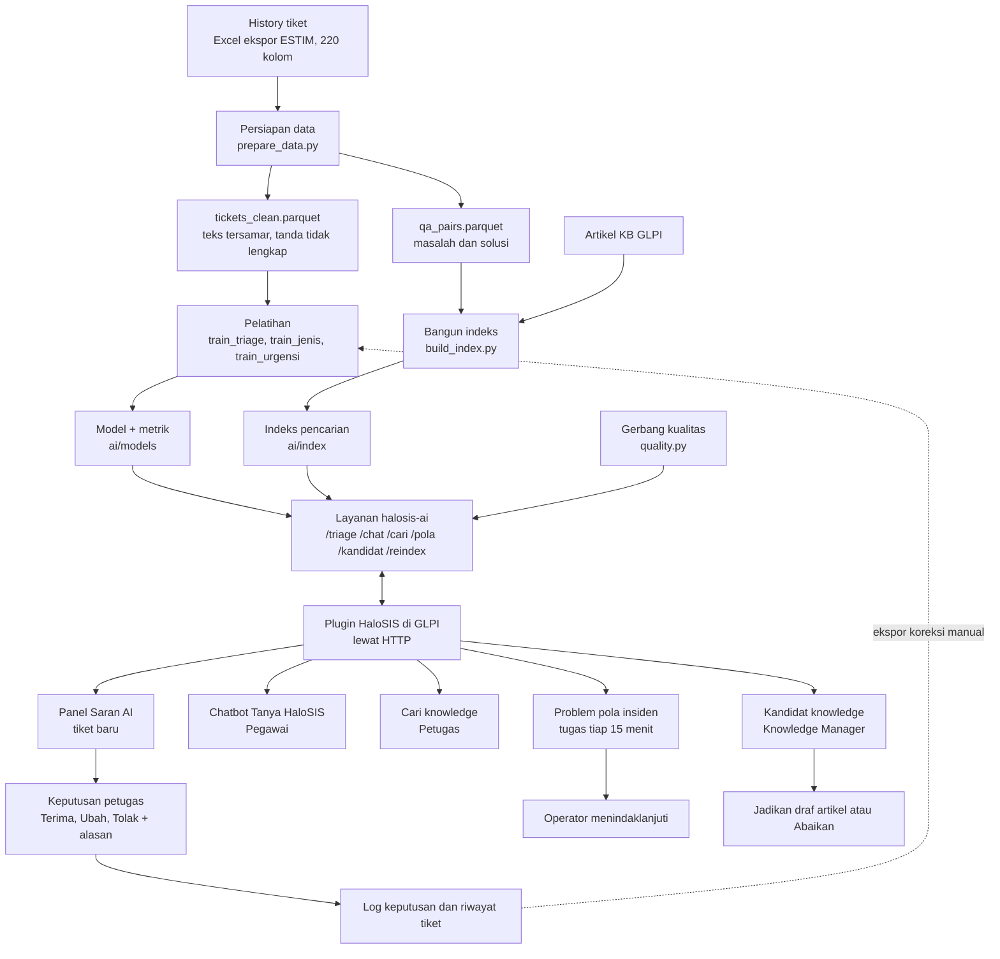

# Cara kerja AI HaloSIS, langkah demi langkah

Tanggal: 5 Nov 2026 · Branch `dev`, commit `87a1609`. Tujuan: mengecek kesesuaian implementasi dengan PoC di dokumen
*Kelompok 4 AKPSI-6* §2.4.7 (hal. 48–60). Nomor halaman mengikuti PDF AKPSI-6 tersebut.

**Cara dokumen ini dibuat.** Sumber kebenarannya adalah kode (`ai/`, `plugins/halosis/src/`), metrik tersimpan
(`ai/models/*.metrics.json`), dan `reports/`. README tidak dipakai sebagai bukti. Tidak ada kode, tes, atau pelatihan
yang dijalankan, dan data olahan serta berkas `.joblib` tidak dibuka. Karena itu:

- Metrik model jenis diambil dari `reports/triase.md`, sebab model ini tidak punya berkas `.metrics.json`.
- Hasil tes dikutip dari laporan terakhir: 51 tes AI lulus pada 1 Nov (`reports/verifikasi_akhir.md:96`), tidak diulang.

Rujukan ditulis `file:baris`, relatif dari folder proyek.

**Ringkasan untuk pembaca cepat**

- AI HaloSIS hanya **menyarankan**. Keputusan tetap di tangan petugas (Terima/Ubah/Tolak).
- Ada enam komponen: triase tim, jenis REQ/INC, urgensi, pencarian/chatbot, deteksi pola insiden, kandidat pengetahuan.
- Semua model berjalan lokal di layanan `halosis-ai`. Claude hanya dipakai bila API key diisi, dan bawaannya kosong.
- Bila layanan AI mati, tiket tetap tersimpan dan fitur turun ke cara manual atau kata kunci.
- Implementasi **tidak identik** dengan PoC. Perbedaannya ada di §4, dan masalah yang perlu ditindaklanjuti ada di §5.3.

---

## 1. Gambaran umum



Pembagian tugasnya:

| Bagian | Isi | Bukti |
| --- | --- | --- |
| Pipeline luring | Data disiapkan, model dilatih, indeks dibangun, dijalankan manual oleh Pengelola AI | `ai/scripts/` |
| Layanan AI | FastAPI, memuat model sekali saat mulai, input disamarkan dulu | `ai/service/app.py:83-107`, `:15` |
| Plugin GLPI | Memanggil layanan lewat HTTP (batas waktu bawaan 8 detik), menyimpan saran dan keputusan | `plugins/halosis/src/Ai/Service.php:43-77`, `Config.php:33` |
| Petugas | Satu-satunya pihak yang mengubah tiket | `plugins/halosis/src/Triage.php:634-699` |

---

## 2. Persiapan data

### 2.1 Sumber dan kolom

- **Sumber:** ekspor history `data ticketing (202601_202608).xlsx`, 220 kolom (`ai/scripts/prepare_data.py:3-5`, `:30`). Ekspor
  lama 137 kolom hanya dipakai untuk rekonsiliasi (`ai/scripts/prepare_data.py:29`).
- **Kolom yang dipakai:** jenis, nomor, judul, deskripsi, tim, status, tanggal dibuka/selesai/ditutup, percakapan,
  catatan penutupan, hasil SLA, urgensi, dampak, prioritas, rating (`ai/scripts/prepare_data.py:35-42`).
- **Tanggal:** serial Excel diubah menjadi tanggal (`ai/halosis_ai/dates.py:21-29`).

### 2.2 Penyamaran data pribadi

Urutannya penting: kata sandi lebih dulu, lalu email, NIP, NIK, telepon, nama (`ai/halosis_ai/privacy.py:42-55`).

1. Nilai setelah kata sandi/PIN/OTP menjadi `[RAHASIA]`, email `[EMAIL]`, NIP `[NIP]`, NIK `[NIK]`, HP `[TELEPON]`.
2. Nama setelah sapaan, nama lengkap, dan bagian nama dari kolom pengguna menjadi `[NAMA]`. Bagian nama yang juga kata
   umum (muncul ≥ 5 kali berhuruf kecil) tidak disamarkan (`ai/scripts/prepare_data.py:68-88`).
3. Kolom nama dihapus. ID pengguna diganti `U00001` dst., dan pemetaannya tidak disimpan
   (`ai/scripts/prepare_data.py:94-101`).
4. Hasil dipindai ulang. Bila masih ada pola data pribadi, keluaran **tidak disimpan** (`ai/scripts/prepare_data.py:227-232`).

Hasil: 17.015 nilai disamarkan (`reports/rekonsiliasi.md:61`). Saat aplikasi berjalan, plugin menyamarkan lagi
(`plugins/halosis/src/Privacy.php:14-29`), dan layanan AI menyamarkan sekali lagi (`ai/service/app.py:361`,
`ai/halosis_ai/triage_model.py:30-31`). Saringan PHP tidak mengenali nama. Saringan layanan saat berjalan hanya mengenali
nama setelah sapaan, karena daftar nama pengguna hanya ada saat pipeline luring.

### 2.3 Pembersihan dan penanda data tidak lengkap

Data bermasalah **ditandai, tidak dibuang** (`ai/scripts/prepare_data.py:52-59`, `:144-147`):

| Penanda | Baris | Bukti |
| --- | ---: | --- |
| Tanpa deskripsi | 34 | `reports/rekonsiliasi.md:35` |
| Tanpa tim | 3 | `reports/rekonsiliasi.md:36` |
| Selesai tanpa solusi yang bisa diambil | 758 | `reports/rekonsiliasi.md:37` |
| Total ditandai (satu baris bisa punya beberapa alasan) | 790 | `reports/rekonsiliasi.md:14` |

Hasil SLA yang memakai perkiraan juga ditandai di kolom `sla_imputasi` (`ai/scripts/prepare_data.py:142`).

### 2.4 Ekstraksi solusi

Teks solusi diambil dari percakapan untuk indeks pencarian (`ai/halosis_ai/conversations.py:109-125`):

1. Percakapan dipecah per pesan (`ai/halosis_ai/conversations.py:65-77`).
2. Pesan ditelusuri dari yang terakhir. Pesan lebih dari 5 menit sesudah tiket diselesaikan dilewati, karena biasanya
   berisi ucapan terima kasih atau survei (`ai/halosis_ai/conversations.py:106`, `:116-120`).
3. Pesan terakhir dari pemohon dilewati (`ai/halosis_ai/conversations.py:121-122`).
4. Kalimat template dan salam dibuang. Sisanya harus ≥ 5 kata dan bukan sekadar permintaan informasi atau keluhan
   (`ai/halosis_ai/conversations.py:90-101`).
5. Bila tidak ada, dipakai `close_notes`, lalu `resolution`, asalkan bukan template (`ai/scripts/prepare_data.py:135-137`).

Hanya tiket berstatus Closed/Resolved/Completed dengan solusi yang masuk `qa_pairs` (`ai/scripts/prepare_data.py:169-181`).

### 2.5 Jumlah baris dan pembagian data

Baris sumber 6.681, berhasil diproses 6.671, gagal 10 karena status tidak dikenal (`reports/rekonsiliasi.md:11-13`, `:26`).
Dokumen mencatat 6.682, selisih 1 REQ tanpa nomor (`reports/verifikasi_akhir.md:78`).

| Komponen | Cara bagi | Data | Bukti |
| --- | --- | --- | --- |
| Triase tim | Waktu: latih sebelum 1 Jul, uji sesudahnya. Pilih pengaturan: latih Jan–Mei, validasi Juni | 5.109 latih, 1.559 uji | `ai/scripts/train_triage.py:40-41`, `reports/triase.md:9` |
| Jenis REQ/INC | Waktu, sama dengan triase | 5.122 latih, 1.559 uji | `ai/scripts/train_jenis.py:29`, `reports/triase.md:143` |
| Urgensi | Validasi silang 5 lipatan bertingkat, seed 42, hanya insiden Medium/Low | 2.708 insiden | `ai/scripts/train_urgensi.py:43`, `:60-64`, `ai/models/urgensi.metrics.json` |
| Pencarian | Uji: korpus Jan–Jun, kueri Jul–Ags. Indeks aktif memuat semua bulan | 1.069 kueri | `reports/banding_solusi.md:7`, `ai/scripts/build_index.py:61-62` |
| Pola insiden | Tanpa pelatihan. Uji pada blok 1 jam | 666 insiden, 84 blok | `reports/banding_pola.md:7-9` |
| Kandidat pengetahuan | Tanpa pelatihan dan tanpa set uji | – | `ai/halosis_ai/candidates.py:27-68` |

Indeks aktif berisi 4.923 potongan: 4.897 tiket, 9 KB, 17 layanan (`reports/checklist_demo.md:24`). Ukuran
`ai/index/vectors.npy` cocok dengan jumlah itu. Jumlah baris `qa_pairs` tidak tercatat di laporan mana pun.

---

## 3. Komponen AI

### 3.1 Triase tim

**Tujuan.** Menyarankan tim penangan beserta keyakinannya, agar Operator tidak memilah dari nol.

**Input.** Hanya yang tersedia saat tiket dibuat: judul, deskripsi, jenis. Kolom routing, SLA, dan resolusi tidak dipakai
(`ai/scripts/train_triage.py:4-5`, `ai/halosis_ai/triage_model.py:28-35`). Label latihnya tim akhir.

**Langkah pemodelan.**

1. Teks disusun: token jenis, judul dua kali, deskripsi. Huruf kecil, angka menjadi `0` (`ai/halosis_ai/triage_model.py:28-35`).
2. Tim dengan < 30 tiket latih digabung ke "Lainnya" (`ai/scripts/train_triage.py:55-59`). Hasilnya 21 kelas
   (`reports/triase.md:10`).
3. Fitur TF-IDF kata (1–2 gram) ditambah karakter (3–5 gram, tahan salah ketik) (`ai/halosis_ai/triage_model.py:44-49`).
4. Pengaturan dipilih dari C = 3/10/30, dengan/tanpa bobot kelas, pada validasi Juni (`ai/scripts/train_triage.py:42`,
   `:82-92`). Terpilih C = 3 tanpa bobot (`reports/triase.md:43`).
5. Logistic Regression, probabilitasnya dikalibrasi (sigmoid, 5 lipatan) (`ai/halosis_ai/triage_model.py:50-52`).
6. Keyakinan = probabilitas tim teratas. Di bawah 0,70, atau tim teratas "Lainnya", ditandai perlu penilaian manual
   (`ai/halosis_ai/triage_model.py:25`, `:153-158`).
7. Tiga tiket latih paling mirip (TF-IDF, kosinus) disimpan sebagai penjelasan (`ai/halosis_ai/triage_model.py:112-134`).

**Evaluasi** pada 1.559 tiket Jul–Ags (`ai/models/triage.metrics.json`, `reports/triase.md:9-18`):

| Ukuran | Hasil |
| --- | ---: |
| Top-1 / Top-3 | 75,88% / 94,87% |
| MRR / F1 makro | 0,8563 / 69,00% |
| Pembanding "selalu tim terbanyak" | 10,97% |
| Keyakinan ≥ 70% | akurasi 88,35%, cakupan 50,67% tiket |
| Keyakinan < 70% | akurasi 63,07%, cakupan 49,33% tiket |
| Galat kalibrasi (ECE) | 9,37% |

Keyakinan model cenderung **lebih rendah** dari akurasinya. Contoh: pita 50–70% berakurasi 73,8%, dan tidak ada tiket di
pita 90% ke atas (`reports/triase.md:51-54`). Tim terlemah: Operator Pusat (recall 3,0%, presisi 8,3%) dan FASIH
(presisi 21,0%, recall 78,8%) (`reports/triase.md:67`, `:72`).

**Gerbang kualitas** (`ai/halosis_ai/quality.py:15-18`, `:80-90`, `reports/tata_kelola_ai.md:30`):

| Syarat | Batas | Model aktif |
| --- | --- | ---: |
| Top-1 | ≥ 0,68 (baseline PoC) | 0,7588 |
| Akurasi pada keyakinan ≥ ambang | ≥ 0,85 | 0,8835 |
| Recall tim besar terendah (tanpa "Lainnya") | ≥ 0,50 | 0,787 |
| Top-1/Top-3 dibanding versi sebelumnya | turun ≤ 2 poin | naik (0,7447 → 0,7588, 0,9301 → 0,9487) |

Model yang gagal saat latih ulang tidak menggantikan model aktif (`ai/scripts/train_triage.py:194-198`).

**Di aplikasi.**

1. Tiket baru memicu `Triage::onTicketAdd`, plugin memanggil `POST /triage`. Kegagalan AI tidak menggagalkan penyimpanan
   tiket (`plugins/halosis/src/Triage.php:95-106`, `:381-385`).
2. Nama tim history dipetakan ke kategori dan grup GLPI (`plugins/halosis/src/Triage.php:75-89`, `:523-546`). Tim yang tidak
   terpetakan memakai saran aturan kata kunci dan diberi catatan.
3. Bila selisih keyakinan dua kandidat teratas < 5 poin, tim dengan tiket aktif lebih sedikit disarankan
   (`plugins/halosis/src/Triage.php:495-518`).
4. Panel "Saran AI" menampilkan kategori, dampak, urgensi, prioritas, grup, tiga kandidat beserta beban kerjanya, dan tiket
   mirip (`plugins/halosis/templates/triase_panel.html.twig:93-116`, `:151-155`).

| Tingkat di panel | Syarat | Yang dilihat petugas | Bukti |
| --- | --- | --- | --- |
| Tinggi | Keyakinan ≥ 70 | "Direkomendasikan" | `plugins/halosis/src/Suggestion.php:81` |
| Sedang | 40–69 | "Pilih dari 3 kandidat" | `plugins/halosis/src/Suggestion.php:82` |
| Rendah | < 40, tim "Lainnya", atau model tidak lolos gerbang | "Perlu penilaian manual" | `plugins/halosis/src/Suggestion.php:76-78`, `Triage.php:458-461` |

Petugas memilih Terima, Ubah, atau Tolak. Ubah dan Tolak wajib beralasan minimal 5 karakter
(`plugins/halosis/src/Triage.php:33-34`, `:648-651`). Keputusan dicatat di tabel plugin dan Riwayat tiket
(`plugins/halosis/src/Triage.php:678-697`). Tiket tidak pernah berubah tanpa keputusan petugas.

**Bila mati.**

| Kondisi | Yang terjadi | Bukti |
| --- | --- | --- |
| Layanan gagal, tanpa API key | Tiket tersimpan tanpa saran. Operator menekan "Buat saran AI", atau tugas `TriageRetry` mencoba lagi | `plugins/halosis/src/Triage.php:129-136` |
| Tugas `TriageRetry` | Tiap 15 menit, maks. 5 kali per tiket, tiket ≤ 3 hari | `plugins/halosis/src/TriageRetry.php:23-29`, `plugins/halosis/hook.php:240` |
| Layanan gagal, API key diisi | Dicoba lewat penyedia AI eksternal | `plugins/halosis/src/Triage.php:138-139` |
| URL layanan dikosongkan | Aturan kata kunci (mode demo) | `plugins/halosis/src/Triage.php:139`, `:551-625` |
| Model belum lolos gerbang | Saran tampil sebagai referensi, tingkat Rendah, ada peringatan | `plugins/halosis/src/Triage.php:404-406`, `templates/triase_panel.html.twig:85-90` |

### 3.2 Jenis tiket REQ/INC

**Tujuan.** Memberi tahu petugas bila jenis tiket tampak salah. Ini penting karena tiket dari chatbot selalu dibuat sebagai
Insiden (`plugins/halosis/src/Chatbot.php:497`).

**Input.** Judul dan deskripsi, tanpa token jenis (`ai/halosis_ai/triage_model.py:38-40`).

**Langkah pemodelan.**

1. Fitur sama dengan triase (`ai/scripts/train_jenis.py:58`).
2. Logistic Regression C = 3, bobot kelas seimbang, dikalibrasi. Pengaturan ini tetap, tidak dipilih dari kisi
   (`ai/scripts/train_jenis.py:61`).
3. Ambang tampil 0,70 (`ai/scripts/train_jenis.py:30`).

**Evaluasi** pada 1.559 tiket Jul–Ags (`reports/triase.md:141-148`): akurasi 68,25%, F1 makro 67,52%, pembanding jenis
terbanyak 57,28%. Pada keyakinan ≥ 70%: akurasi 83,96%, cakupan 40,80%.

**Gerbang.** F1 makro harus mengungguli pembanding kelas mayoritas (0,6752 > 0,3642, `reports/audit_dokumen_e2e.md:173`) dan
tidak turun > 2 poin dari versi aktif (`ai/halosis_ai/quality.py:103-110`). Kandidat yang gagal tidak menggantikan model aktif
(`ai/scripts/train_jenis.py:64-72`).

**Di aplikasi.** Bagian dari jawaban `/triage` (`ai/service/app.py:255-263`). Panel menampilkan "Jenis disarankan" bila berbeda
dan keyakinan ≥ ambang, atau "Jenis: perlu ditinjau" pada keyakinan 40–69 (`plugins/halosis/src/TriagePanel.php:123-137`).
Petugas mengubah jenis di form tiket.

**Bila mati.** Model opsional. Bila tidak ada atau tidak lolos, `jenis_saran` kosong dan panel diam
(`ai/service/app.py:90-95`, `:257-259`).

### 3.3 Urgensi insiden

**Tujuan.** Menyarankan urgensi insiden Rendah atau Sedang. Dampak dan prioritas diturunkan dari sini.

**Input.** Judul dan deskripsi, ditambah nama tim (`ai/halosis_ai/triage_model.py:56-58`). Label dari kolom `urgency`. Urgensi
High (12 tiket), urgensi kosong (57 tiket), dan seluruh REQ tidak dimodelkan (`ai/models/urgensi.metrics.json`).

**Langkah pemodelan.**

1. Fitur: TF-IDF kata dan karakter, ditambah one-hot nama tim (`ai/halosis_ai/triage_model.py:67-73`).
2. Logistic Regression C = 3, bobot kelas seimbang, keluarannya P(Low) (`ai/halosis_ai/triage_model.py:61-74`). Model ini
   **tidak dikalibrasi**.
3. P(Low) dihitung lewat validasi silang 5 lipatan (`ai/scripts/train_urgensi.py:62-65`).
4. Ambang per kelas dipilih otomatis dengan kisi 0,05 (`ai/halosis_ai/triage_model.py:99-109`): Low bila P(Low) ≥ 0,90, Medium
   bila P(Low) ≤ 0,45. Di antaranya, model tidak memberi saran.
5. Model akhir dilatih pada semua data berlabel (`ai/scripts/train_urgensi.py:90`).

**Evaluasi** (validasi silang, `ai/models/urgensi.metrics.json`, `reports/triase.md:162-166`):

| Kelas | Aturan | Hasil | Pembanding |
| --- | --- | --- | ---: |
| Low | P(Low) ≥ 0,90 | presisi 78,79% (Wilson 62,25–89,32%), recall 5,12%, 33 tiket | 18,76% |
| Medium | P(Low) ≤ 0,45 | akurasi 84,30%, cakupan 76,70% | 81,24% |
| Di antaranya | – | 22,08% insiden, memakai aturan kata kunci | – |

Tanpa ambang per kelas, akurasinya 74,30%, lebih rendah dari pembanding. Sebanyak 81,24% label bernilai Medium, kemungkinan
nilai bawaan formulir (`reports/triase.md:170`, `:173`).

**Gerbang** per kelas (`ai/halosis_ai/quality.py:36-52`):

| Kelas | Syarat | Status |
| --- | --- | --- |
| Low | presisi ≥ 75%, batas bawah Wilson > pembanding, ≥ 30 tiket | Lolos |
| Medium | akurasi > pembanding + 3 poin, ≥ 30 tiket | Lolos tipis (84,30% vs syarat > 84,24%) |

Kelas yang gagal tidak pernah disarankan (`ai/service/app.py:275-284`).

**Di aplikasi.**

1. Layanan mengirim saran hanya bila kelasnya lolos dan P(Low) melewati ambang (`ai/service/app.py:266-286`).
2. Plugin memakainya hanya untuk insiden, dan hanya bila aturan kata kunci tidak menemukan desakan Tinggi/Sangat tinggi
   (`plugins/halosis/src/Triage.php:412-417`).
3. Pemohon pejabat menaikkan urgensi satu tingkat (`plugins/halosis/src/Triage.php:190-195`).
4. Dampak = urgensi, naik satu tingkat bila ada ≥ 3 tiket serupa dalam jendela pola atau layanannya kritis (bawaan SSO, Email,
   Jaringan) (`plugins/halosis/src/Triage.php:183-208`, `plugins/halosis/src/Config.php:48`).
5. Prioritas mengikuti matriks GLPI (`plugins/halosis/src/Triage.php:155`).
6. Panel menampilkan urgensi disarankan dan alasan dampak (`plugins/halosis/templates/triase_panel.html.twig:119-125`).

**Bila mati.** Urgensi kembali ke aturan kata kunci (`plugins/halosis/src/Triage.php:574-587`).

### 3.4 Pencarian dan chatbot

**Tujuan.** Menjawab pegawai sebelum tiket dibuat (`/chat`) dan membantu petugas mencari solusi lama (`/cari`).

**Input.** Pertanyaan yang sudah disamarkan. Korpusnya artikel KB terbit, solusi tiket lama, dan katalog layanan
(`ai/scripts/build_index.py:3-9`).

**Langkah pemodelan.**

1. Teks dipotong per 220 kata. Setiap potongan tiket memuat teks masalah utuh (`ai/halosis_ai/search.py:25`, `:53-79`).
2. Potongan diubah menjadi vektor 768 dimensi dengan `intfloat/multilingual-e5-base`, berawalan `passage:` untuk dokumen dan
   `query:` untuk pertanyaan (`ai/halosis_ai/search.py:23`, `:88-92`).
3. Vektor disimpan sebagai berkas `chunks.parquet` dan `vectors.npy`, bukan layanan basis data vektor
   (`ai/scripts/build_index.py:83-85`).
4. Pencarian = kosinus, satu hasil per sumber (`ai/halosis_ai/search.py:157-180`).
5. Keputusan chatbot (`ai/service/app.py:51-57`, `:356-384`):

| Skor | Mode | Yang dilihat pegawai |
| --- | --- | --- |
| ≥ 0,83 | `ekstraktif` (bawaan) atau `claude` | Solusi teratas apa adanya beserta sumber, atau rangkuman Claude bila API key ada |
| 0,78 sampai < 0,83, ada artikel KB | `pilihan` | Tidak dijawab, ditawari ≤ 3 judul artikel "Maksud Anda…?" dan Buat laporan |
| < 0,78, atau tidak ada artikel KB | `tidak-ditemukan` | "Belum menemukan jawaban", ditawari Buat laporan |

Prompt Claude melarang fakta tambahan dan membatasi jawaban pada potongan sumber (`ai/service/app.py:326-334`).

**Evaluasi.** Tidak ada penilaian manusia. Relevansi didekati dengan kesamaan tim: hasil dianggap benar bila berasal dari tiket
tim yang sama.

| Set uji | Top-1 | Top-3 | MRR | Bukti |
| --- | ---: | ---: | ---: | --- |
| Indeks aktif (aturan solusi baru, 1.069 kueri) | 72,50% | 89,06% | 0,8115 | `reports/banding_solusi.md:16` |
| e5 pada ekspor lama (906 kueri) | 72,74% | 89,62% | 0,8144 | `reports/banding_embedding.md:21` |
| MiniLM PoC pada set sama (906 kueri) | 67,99% | 83,55% | 0,7650 | `reports/banding_embedding.md:20` |

Latensi `/chat`: p95 453,8 ms, dari 20 permintaan mode ekstraktif pada 29 Okt (`reports/latensi.md:9-11`). Generasi Claude belum
pernah diukur (n = 0, `reports/latensi.md:10`). Penggabungan solusi identik ditolak karena Top-1 turun 1,96 poin
(`reports/banding_solusi.md:35`).

**Gerbang.** Tidak ada gerbang otomatis. Ada syarat pada perubahan aturan solusi: turun ≤ 1 poin (`ai/scripts/banding_solusi.py:41`).
Penjaganya ambang skor dan pemindaian pola pribadi sebelum indeks ditulis (`ai/scripts/build_index.py:77-80`).

**Di aplikasi.**

- Pegawai bertanya di Tanya HaloSIS. Plugin menyaring dulu topik non-TI (kepegawaian, keuangan, umum) dan mengarahkannya ke unit
  terkait tanpa memanggil AI (`plugins/halosis/src/Chatbot.php:33-39`, `:140-148`).
- Sumber artikel dicek hak aksesnya. Bila pegawai tidak berhak, jawaban layanan dibuang dan dipakai pencarian KB lokal
  (`plugins/halosis/src/Chatbot.php:238-245`).
- Pegawai bisa menilai 1–5 atau membuat tiket dari percakapan (`plugins/halosis/src/Chatbot.php:463-507`).
- Petugas memakai halaman Cari knowledge: 10 hasil tanpa ambang, dengan tombol membantu/tidak membantu
  (`plugins/halosis/src/Controller/CariKnowledgeController.php:28-45`, `ai/service/app.py:442-452`, `plugins/halosis/ajax/feedback.php:4`).
- Artikel yang terbit, berubah, atau dihapus memperbarui indeks otomatis (`plugins/halosis/src/KnowledgeIndex.php:34-37`, `:113-121`).

**Bila mati.** Chatbot turun ke pencarian kata kunci atas artikel KB (`plugins/halosis/src/Chatbot.php:152-172`), lalu kutipan
artikel atau "belum menemukan". Cari knowledge turun ke mode kata kunci
(`plugins/halosis/src/Controller/CariKnowledgeController.php:46-50`). Kegagalan re-index hanya dicatat, dan indeks lama tetap
dipakai (`plugins/halosis/src/KnowledgeIndex.php:147-151`).

### 3.5 Deteksi pola insiden

**Tujuan.** Memberi peringatan dini bila banyak tiket mirip muncul dalam waktu singkat. Sistem tidak memperbaiki apa pun.

**Input.** Insiden belum selesai dalam 60 menit terakhir: judul dan 300 karakter awal deskripsi
(`plugins/halosis/src/PatternDetector.php:176-204`, `ai/service/app.py:396`). REQ ikut hanya bila diaktifkan
(`plugins/halosis/src/Config.php:46`).

**Langkah pemodelan.**

1. Teks diubah menjadi vektor e5 (`ai/service/app.py:397`).
2. Vektor dipusatkan: dikurangi rata-rata vektor indeks, lalu dinormalkan. Kosinus e5 mentah terlalu tinggi, bahkan untuk tiket
   tidak terkait (`ai/halosis_ai/patterns.py:3-6`, `:28-32`).
3. Metode bawaan `rata`: tiket urut waktu masuk ke kelompok dengan rata-rata kemiripan tertinggi bila ≥ 0,50 dan masih dalam
   jendela waktu; bila tidak, membuka kelompok baru (`ai/halosis_ai/patterns.py:35-56`).
4. Metode opsional `dbscan`: eps 0,50, min_samples 3, lalu anggota di luar jendela dibuang (`ai/halosis_ai/patterns.py:74-99`).
5. Kelompok < 3 tiket dibuang (`ai/halosis_ai/patterns.py:22-25`, `:61-62`).

**Evaluasi** pada 666 insiden Jul–Ags, 84 blok 1 jam (`reports/banding_pola.md:7-9`, `:15-19`). Kualitas didekati dengan
kemurnian tim, bukan penilaian manusia.

| Metode | Kelompok | Tiket terkelompok | Kemurnian tim |
| --- | ---: | ---: | ---: |
| Rata-rata ≥ 0,50 (bawaan) | 7 | 22 | 0,905 |
| DBSCAN eps 0,50, min 3 | 8 | 25 | 0,917 |
| DBSCAN eps 0,40, min 3 | 3 | 10 | 0,889 |

**Gerbang.** Tidak ada gerbang angka. Pengendaliannya berupa ambang tetap dan validasi manusia.

**Di aplikasi.**

1. Tugas `IncidentPattern` berjalan tiap 15 menit (`plugins/halosis/hook.php:235`).
2. Plugin memanggil `POST /pola` (`plugins/halosis/src/PatternDetector.php:228-247`).
3. Setiap kelompok menjadi Problem "Pola insiden: …", status Baru, dampak 4, ditugaskan ke grup Operator
   (`plugins/halosis/src/PatternDetector.php:358-378`). Pola yang masih terbuka menerima tiket baru, bukan Problem baru
   (`plugins/halosis/src/PatternDetector.php:353-355`, `:393-402`).
4. Petugas melihat banner pola, tautan pola di panel tiket, dan tren 12 minggu di dashboard
   (`plugins/halosis/src/PatternDetector.php:589-610`, `plugins/halosis/src/TriagePanel.php:183-190`,
   `plugins/halosis/src/Stats.php:544-574`). Petugas memutuskan tindak lanjutnya (`plugins/halosis/src/PatternDetector.php:520`).

**Bila mati.** Plugin memakai metode kata kunci: kategori sama, lalu judul dengan ≥ 2 kata sama dan overlap ≥ 0,5
(`plugins/halosis/src/PatternDetector.php:40-44`, `:276-344`). Metode yang dipakai ditulis di Problem
(`plugins/halosis/src/PatternDetector.php:499-517`).

### 3.6 Kandidat pengetahuan

**Tujuan.** Mengubah solusi yang berulang menjadi calon artikel KB untuk dikurasi Knowledge Manager.

**Input.** Ada dua sumber: solusi dalam indeks (`ai/halosis_ai/candidates.py:27-41`), dan tiket GLPI selesai dengan solusi ≥ 20
karakter yang tidak ditolak pemohon (`plugins/halosis/src/KnowledgeCandidates.php:54-99`).

**Langkah pemodelan.**

1. Satu baris per tiket, teks solusi dijadikan TF-IDF 1–2 gram (`ai/halosis_ai/candidates.py:30`, `:44`).
2. Dua solusi dianggap tetangga bila kosinus ≥ 0,75 (`ai/halosis_ai/candidates.py:16`, `:45`).
3. Solusi dengan tetangga terbanyak menjadi pusat klaster, anggotanya tidak dipakai lagi (`ai/halosis_ai/candidates.py:46-56`).
4. Syarat klaster: solusi pusat ≥ 10 kata dan ≥ 5 tiket, maksimal 20 klaster (`ai/halosis_ai/candidates.py:18`, `:27`, `:51-54`).

**Evaluasi.** Tidak ada metrik mutu. Hanya tes unit `ai/tests/test_candidates.py` dan uji alur dalam `reports/verifikasi_akhir.md:90`.

**Gerbang.** Kurasi manusia. Tidak ada yang terbit otomatis.

**Di aplikasi.** `GET /kandidat` (`ai/service/app.py:455-464`). Hasilnya disinkronkan plugin
(`plugins/halosis/src/KnowledgeCandidates.php:37-42`, `:104-137`). Knowledge Manager memilih "Jadikan artikel", yang membuat **draf**
tanpa target visibilitas (`plugins/halosis/src/KnowledgeCandidates.php:243-275`), atau "Abaikan" dengan alasan
(`plugins/halosis/src/KnowledgeCandidates.php:291-303`).

**Bila mati.** Sinkronisasi tetap membuat kandidat dari tiket GLPI dan melaporkan AI tidak tersedia
(`plugins/halosis/src/KnowledgeCandidates.php:37-42`, `:109-114`).

---

## 4. Banding PoC dan implementasi

Arti kolom **Status**: *Sama*, *Sama, diperluas*, *Beda*, *Tidak diulang*, *Tidak sebanding*.

Arti tanda pada kolom **Bukti uji**:

- ✓ = ada uji banding pada set data yang sama.
- ⚠ = ada angka atau tes pendukung, tetapi bukan banding pada set yang sama.
- ✗ = belum ada uji.
- – = tidak perlu banding.

### 4.1 Data dan triase

| # | Butir | Dokumen (hal.) | Implementasi | Status | Alasan | Bukti uji |
| --- | --- | --- | --- | --- | --- | --- |
| 1 | Platform inti | GLPI 78/100, Zammad 76/100 (58, 60) | Plugin di atas GLPI (`reports/rencana_uji.md:126`) | Sama | – | – `reports/verifikasi_akhir.md:24` |
| 2 | Posisi AI | Lapisan luar lewat API (54, 58–59) | Saat berjalan lewat HTTP. Pengecualian: `build_index.py` membaca DB GLPI (§5.3 no. 6) | Sama, ada pengecualian luring | – | – `ai/scripts/build_index.py:43-47` |
| 3 | Dataset | 6.700 baris, 6.682 valid: 3.905 REQ, 2.777 INC (50–51) | Ekspor 220 kolom, 6.681 baris | Beda | Ekspor baru memuat urgensi, dampak, prioritas, rating | ⚠ `reports/rekonsiliasi.md:11-13`, `reports/tata_kelola_ai.md:91` |
| 4 | Populasi routing | 6.659 tiket (51) | 6.668 tiket | Beda | Ikut ekspor baru | ⚠ `reports/triase.md:9` |
| 5 | Cara split | Acak, random_state 42, uji 20%: 5.319 / 1.339 (51) | Waktu: Jan–Jun / Jul–Ags, 5.109 / 1.559 | Beda | Meniru pemakaian nyata (`reports/triase.md:27`) | ⚠ Tidak ada uji split acak pada data baru |
| 6 | Jumlah kelas | 39 grup (51, 54) | 21 kelas, tim < 30 tiket → "Lainnya" | Beda | Tim kecil tidak bisa dipelajari andal. "Lainnya" selalu manual | ⚠ `reports/triase.md:10`, `:60-80`, tes `test_lainnya_selalu_penilaian_manual`. Tidak ada uji 39 kelas |
| 7 | Metode triase | TF-IDF dibanding embedding (54); hal. 113 menyebut Similarity/Embedding | TF-IDF kata + karakter, Logistic Regression terkalibrasi. Tanpa embedding | Beda | Alasan memilih metode ini tidak tercatat di laporan | ⚠ `reports/triase.md:11-18`. Tidak ada banding dengan embedding |
| 8 | Metrik triase | Top-1 68,33 / 70,43%, Top-3 90,89 / 90,29%, MRR 0,7989 / 0,8092 (54) | Top-1 75,88%, Top-3 94,87%, MRR 0,8563, ditambah F1 makro | Sama jenis metriknya, nilainya tidak sebanding | Kelas, split, dan ekspor berbeda (`reports/verifikasi_akhir.md:79`) | – `ai/models/triage.metrics.json` |
| 9 | Kinerja per tim | Operator Pusat 70 dari 83 tiket salah; kinerja tidak merata (55) | Operator Pusat recall 3,0% dari 67 tiket (±65 salah) | Sama temuannya, kelemahan masih ada | Tiket Operator Pusat beragam | – `reports/triase.md:67` |
| 10 | Confidence-aware | Kandidat Top, confidence, validasi manusia (54); tiga tingkat (100) | Tingkat 70/40, Top-3, "Lainnya" selalu manual | Sama, diperluas | – | – `reports/triase.md:16-17`, `ai/tests/test_triage_model.py:40`. Ambang 40 belum diuji |

### 4.2 Pencarian dan jawaban

| # | Butir | Dokumen (hal.) | Implementasi | Status | Alasan | Bukti uji |
| --- | --- | --- | --- | --- | --- | --- |
| 11 | Model embedding | `paraphrase-multilingual-MiniLM-L12-v2` (53, 56) | `intfloat/multilingual-e5-base` | Beda | Lebih baik di ketiga metrik; biayanya pengodean ±4–6× lebih lambat | ✓ `reports/banding_embedding.md:20-21`. Skrip ujinya tidak ada di repo |
| 12 | Uji retrieval terkendali | 8 kasus: TF-IDF dan embedding sama-sama 100%, MRR 1,0 (53) | Tidak diulang. Diganti uji proksi tim, 1.069 kueri | Tidak diulang | Tidak ada label relevansi manual | ⚠ `reports/banding_solusi.md:16`, `:38` |
| 13 | LLM | Qwen2.5 3B lewat Ollama (53, 55) | Tanpa LLM secara bawaan (ekstraktif). Claude opsional. Ollama tidak ada di `docker-compose.yml` | Beda | Tanpa data keluar dan tanpa GPU; kutipan tidak bisa berhalusinasi (`README.md:911`, `reports/audit_kelengkapan.md:198`) | ⚠ `reports/latensi.md:15`, `ai/tests/test_service.py:42`. Mutu jawaban Claude belum diuji |
| 14 | Grounding dan fallback | RAG + grounding + fallback + HITL; ada uji unknown-answer (55–56) | Di bawah ambang tidak menjawab, mode pilihan, tawaran laporan | Sama | – | – `ai/tests/test_service.py:36`, `:88`. Ambang 0,83 lihat §5.3 no. 7 |
| 15 | Similarity E2E | 0,8592 pada satu pertanyaan (55) | Ambang 0,83 untuk e5 | Tidak sebanding | Skala kosinus MiniLM dan e5 berbeda (`reports/banding_embedding.md:36`) | – |

### 4.3 Deteksi pola insiden

| # | Butir | Dokumen (hal.) | Implementasi | Status | Alasan | Bukti uji |
| --- | --- | --- | --- | --- | --- | --- |
| 16 | Metode | DBSCAN atas seluruh INC, lalu sliding window (56) | Bawaan rata-rata kemiripan per jendela; DBSCAN opsional di Pengaturan AI | Beda | Hasil setara, lebih cepat, DBSCAN menarik tiket lain lewat efek rantai | ✓ `reports/banding_pola.md:15-19`, `:23-28`. Skrip ujinya tidak ada di repo |
| 17 | eps | 0,25 (56) | 0,50 pada metode DBSCAN | Beda | Eps PoC untuk MiniLM tanpa pemusatan; jarak tiket bertopik sama pada e5 terpusat ±0,4 | ⚠ `reports/banding_pola.md:18-19`, `:29`. Hanya eps 0,50 vs 0,40; eps 0,25 tidak dijalankan |
| 18 | min_samples | 5 (56) | 3 | Beda | Mengikuti aturan minimum 3 insiden; 5 hampir tidak pernah tercapai per jendela | ⚠ `reports/banding_pola.md:30`, tanpa baris uji min 5 |
| 19 | Similarity | 0,70 (56) | 0,50 pada vektor terpusat, rata-rata ke semua anggota | Beda | Kosinus e5 mentah ±0,85–0,94 bahkan untuk tiket tak terkait | ⚠ `ai/halosis_ai/patterns.py:3-6`, `reports/banding_pola.md:17`. Ambang 0,70 tidak diuji |
| 20 | Jendela | 1 jam (56) | 60 menit, dicek tiap 15 menit | Sama | – | – `plugins/halosis/src/Config.php:39`, `plugins/halosis/hook.php:235` |
| 21 | Minimum insiden | 3 (56) | 3 | Sama | Disamakan pada 29 Okt (`reports/tata_kelola_ai.md:90`) | – `plugins/halosis/src/Config.php:38` |
| 22 | Penggabungan hasil | Tanpa union-find; set tiket ganda dideduplikasi (56) | Pengelompokan rakus; pola terbuka dipakai ulang lewat tanda pola | Beda | Satu Problem per pola agar Operator tidak dibanjiri | ⚠ `plugins/halosis/src/PatternDetector.php:353-355`, `reports/verifikasi_akhir.md:88` |
| 23 | Populasi | 2.777 INC (56) | INC secara bawaan; REQ opsional dan terpisah | Sama, diperluas | FR-04 menyebut request juga | – `reports/verifikasi_akhir.md:52` |
| 24 | Hasil deteksi | 14 klaster, 1.073 noise; 23 jendela → 17 episode (56) | Tidak diulang pada 2.777 INC. Uji lain: 666 INC, 7–8 kelompok | Tidak diulang | Alasan tidak tercatat. Skrip klasterisasi seluruh history tidak ada di repo | ✗ |
| 25 | Tren temporal | Kenaikan bulanan cluster BOT/FASIH (56) | Tren pola per minggu per topik, 12 minggu | Beda bentuk | Dibangun dari Problem yang terdeteksi, bukan klaster history | ⚠ `plugins/halosis/src/Stats.php:544-574` |
| 26 | Validasi pola | Kandidat divalidasi manusia/service owner (57) | Problem status Baru, ditugaskan ke Operator | Sama | – | – `plugins/halosis/src/PatternDetector.php:358-378` |

### 4.4 Human-in-the-loop dan kematangan bukti

| # | Butir | Dokumen (hal.) | Implementasi | Status | Alasan | Bukti uji |
| --- | --- | --- | --- | --- | --- | --- |
| 27 | HITL | Approval solusi native GLPI, tiket #156 (57); Approve/Reject/Override (101–102) | Terima/Ubah/Tolak per saran + alasan. Approval solusi GLPI tetap ada | Sama, diperluas | Keputusan dicatat per rekomendasi, bukan hanya per solusi | – `reports/verifikasi_akhir.md:90`, `tests/e2e/alur_alternatif.js` |
| 28 | Audit trail | Actor, timestamp, decision (57, 102) | Tabel keputusan, versi model per saran, Riwayat tiket, ekspor koreksi | Sama, diperluas | – | – `plugins/halosis/src/Triage.php:678-697`, `reports/tata_kelola_ai.md:44` |
| 29 | Evidence Maturity | 8 area, bukti PoC ≠ siap produksi (59) | Lihat tabel berikut | Sama prinsipnya | – | – |

Status di tabel berikut adalah penilaian pemeriksaan ini, bukan status resmi. Semua area **belum siap produksi**, sesuai hal. 59
dan 61.

| Area | Status PoC (hal. 59) | Bukti implementasi | Status sekarang |
| --- | --- | --- | --- |
| ITSM core | Proven PoC | Regresi demo (`reports/verifikasi_akhir.md:86`) | Diuji di prototipe |
| SLA | Proven PoC | Di luar lingkup AI; regresi demo sama | Diuji di prototipe |
| Knowledge | Proven PoC | Re-index dan tes (`ai/tests/test_reindex.py`) | Diuji di prototipe |
| AI retrieval | PoC proven | 1.069 kueri, proksi tim (`reports/banding_solusi.md:16`) | Diuji pada history, tanpa penilaian manusia |
| AI routing | PoC evidence | 1.559 tiket, split waktu (`reports/triase.md:9-13`) | Bukti lebih dekat ke pemakaian nyata, belum pernah dipakai petugas sungguhan |
| Conversation | Partially proven | Mode ekstraktif dan alur alternatif (`reports/verifikasi_akhir.md:90`) | Partially proven |
| Proactive detection | Partially proven | 666 insiden, proksi tim (`reports/banding_pola.md:15-19`), uji alur 3 tiket (`reports/verifikasi_akhir.md:88`) | Partially proven |
| HITL | Proven PoC | Alur e2e 9/9 (`reports/verifikasi_akhir.md:90`) | Diuji di prototipe |

---

## 5. Hal yang hanya ada di satu sisi

### 5.1 Ada di implementasi, tidak ada di PoC §2.4.7

| Hal | Lokasi |
| --- | --- |
| Model jenis REQ/INC | `ai/scripts/train_jenis.py` |
| Model urgensi insiden dengan ambang per kelas (dokumen hanya menilai kelayakannya, hal. 15) | `ai/scripts/train_urgensi.py` |
| Sinyal dampak: tiket serupa, layanan kritis | `plugins/halosis/src/Triage.php:183-208` |
| Kenaikan urgensi pemohon pejabat | `plugins/halosis/src/Triage.php:190-195` |
| Gerbang kualitas otomatis, tampil di `/health` dan panel | `ai/halosis_ai/quality.py`, `ai/service/app.py:233-252` |
| Kalibrasi probabilitas triase | `ai/halosis_ai/triage_model.py:50-52` |
| Kelas gabungan "Lainnya" | `ai/scripts/train_triage.py:55-59` |
| Tiket mirip sebagai penjelasan saran | `ai/halosis_ai/triage_model.py:112-134` |
| Pemecah seri beban kerja | `plugins/halosis/src/Triage.php:495-518` |
| Pemusatan vektor pola | `ai/halosis_ai/patterns.py:28-32` |
| Aturan ekstraksi solusi dan bandingnya | `ai/halosis_ai/conversations.py:109-125`, `reports/banding_solusi.md` |
| Mode chat `pilihan` dan penolakan topik non-TI | `ai/service/app.py:366-372`, `plugins/halosis/src/Chatbot.php:140-148` |
| Katalog layanan masuk indeks | `plugins/halosis/src/KnowledgeIndex.php:53-81` |
| Kandidat pengetahuan otomatis | `ai/halosis_ai/candidates.py` |
| Fallback kata kunci dan percobaan ulang triase | `plugins/halosis/src/PatternDetector.php:276-344`, `plugins/halosis/src/TriageRetry.php` |
| Ekspor koreksi dan indikator drift | `plugins/halosis/src/Stats.php:399-420`, `:771`, `plugins/halosis/src/Controller/DashboardController.php:63` |
| Ringkasan ekstraktif deskripsi panjang | `plugins/halosis/src/Summary.php` |
| Batas permintaan, metrik Prometheus, log latensi tanpa teks | `ai/service/app.py:72-81`, `:113-159` |

### 5.2 Ada di PoC atau dokumen, tidak diimplementasikan

| Hal | Dokumen (hal.) | Kondisi sekarang |
| --- | --- | --- |
| LLM lokal Qwen2.5 3B lewat Ollama | 53, 55 | Tidak ada. Masih tercatat sebagai sisa opsional (`reports/audit_dokumen_e2e.md:151`) |
| Routing berbasis embedding | 54 | Tidak ada, triase hanya TF-IDF |
| Banding TF-IDF vs embedding per tim | 54–55 | Tidak ada |
| Uji retrieval terkendali 8 kasus | 53 | Tidak ada |
| Klasterisasi DBSCAN atas seluruh history | 56 | Tidak ada. DBSCAN hanya per jendela waktu |
| Evaluasi sliding window 23 → 17 episode | 56 | Tidak ada |
| Layanan basis data vektor | 22 (Tabel 2.10) | Berkas numpy di memori (`reports/audit_kelengkapan.md:199`) |
| Ambang dari validation dataset, cost of error, dan UAT | 100 | Laporan tidak mencatat analisis biaya kesalahan atau UAT untuk ambang |

### 5.3 Catatan pemeriksaan yang perlu ditindaklanjuti

Urut dari yang paling berpengaruh pada kesimpulan.

| No | Temuan | Dampak | Bukti |
| --- | --- | --- | --- |
| 1 | **Urgensi dievaluasi dengan tim akhir, tetapi dipakai dengan tim saran AI.** Plugin tidak mengirim `tim`, jadi layanan memakai tebakan triase | Angka 78,79% dan 84,30% bisa terlalu optimistis untuk pemakaian nyata. Medium hanya lolos 0,06 poin. Belum diukur | `ai/scripts/train_urgensi.py:54`, `plugins/halosis/src/Triage.php:381-385`, `ai/service/app.py:304` |
| 2 | **Ambang urgensi dipilih dan dilaporkan pada prediksi validasi silang yang sama** | Hasil cenderung sedikit lebih baik dari data baru | `ai/scripts/train_urgensi.py:64-67` |
| 3 | **Chatbot langsung mengutip solusi tiket lama yang belum ditinjau.** Dokumen mensyaratkan sumber yang disetujui dan resolusi yang sudah direview | Jawaban lama atau salah bisa sampai ke pegawai | Dokumen hal. 14, 15, 99; `ai/scripts/build_index.py:61-62`, `:75`, `ai/service/app.py:342-353` |
| 4 | **Skrip uji `banding_embedding.md` dan `banding_pola.md` tidak pernah ada di repo.** Hanya `banding_solusi.py` yang ada | Dua keputusan penting tidak bisa diulang dengan cara yang sama | `git log --all`: hanya `ai/scripts/banding_solusi.py` yang tercatat |
| 5 | **Perubahan triase (split, kelas, metode) tidak pernah dibandingkan pada set yang sama dengan PoC** | Kenaikan 68–70% → 75,88% tidak boleh dibaca sebagai peningkatan | `reports/verifikasi_akhir.md:79` |
| 6 | **`build_index.py` membaca DB GLPI langsung.** Dokumen melarang AI mengakses DB GLPI | Langkah luring dan hanya baca, tetapi tetap menyimpang. Bila DB mati, indeks ditulis tanpa KB | Dokumen hal. 96; `ai/scripts/build_index.py:42-51` |
| 7 | **Ambang chat tanpa laporan kalibrasi.** 0,83 hanya dijelaskan di README, 0,78 disebut asumsi, ambang triase bawah 40 tidak diuji | Pemilik ambang tidak punya data untuk mengubahnya | `ai/README.md:186`, `README.md:922`, `reports/tata_kelola_ai.md:14-15` |
| 8 | **Ambang pola 0,50 tidak bisa diubah dari Pengaturan AI,** padahal tata kelola memperlakukannya sebagai parameter yang dimiliki Operator. Plugin tidak mengirim `ambang` | Mengubahnya perlu perubahan kode | `plugins/halosis/src/PatternDetector.php:234-243`, `ai/service/app.py:193`, `plugins/halosis/src/Config.php:264-270`, `reports/tata_kelola_ai.md:16` |
| 9 | **Model triase hanya dilatih pada Jan–Jun.** Jul–Ags tidak ikut dipelajari model aktif | Tim yang melonjak tidak dikenal, contohnya Insiden Keamanan Informasi: 17 tiket latih, 133 tiket uji | `ai/scripts/train_triage.py:138`, `reports/triase.md:104` |
| 10 | **`tata_kelola_ai.md` tertinggal dari kode dan metrik.** Recall "Lainnya" tertulis 0,335, metrik 0,4319. SOP tertulis "belum", padahal artikel berkategori SOP ikut terindeks | Pembaca tata kelola mendapat angka lama | `reports/tata_kelola_ai.md:38`, `:62`, `ai/models/triage.metrics.json`, `seed_halosis.py:197` |
| 11 | **Gerbang akurasi triase hanya berlaku pada ambang 70%.** Ambang di Pengaturan AI bisa diubah tanpa menghitung ulang metrik | Mengubah ambang bisa menjauhkan panel dari kondisi yang diuji | `ai/scripts/model_metrics.py:30`, `plugins/halosis/src/Config.php:261` |
| 12 | **Angka di dokumen PoC:** 5.319 + 1.339 = 6.658, sedangkan populasi 6.659 | Selisih 1 tiket, kecil, perlu dikonfirmasi tim PoC | Dokumen hal. 51 |

---

## 6. Melatih ulang model

### 6.1 Siapa yang berwenang

| Keputusan | Mengerjakan | Memutuskan | Bukti |
| --- | --- | --- | --- |
| Rilis atau rollback model triase | Pengelola AI | Manajemen, setelah konsultasi Operator | `reports/tata_kelola_ai.md:13` |
| Ambang keyakinan triase | Administrator Sistem | Manajemen | `reports/tata_kelola_ai.md:14` |
| Ambang chat | Administrator Sistem | Knowledge Manager | `reports/tata_kelola_ai.md:15` |
| Parameter deteksi pola | Administrator Sistem | Operator | `reports/tata_kelola_ai.md:16` |
| Sumber knowledge | Pengelola AI | Knowledge Manager | `reports/tata_kelola_ai.md:17` |

Pengelola AI adalah 1–2 orang (`reports/tata_kelola_ai.md:22`). Anggota tim lain tidak perlu melatih ulang.

### 6.2 Urutan perintah

Jalankan dari folder proyek. Data mentah tidak boleh masuk repo.

```bash
# 0. Simpan salinan model aktif di luar repo (minimal 2 versi terakhir).
#    Skrip latih langsung menimpa ai/models bila kandidat lolos gerbang.

# 1. Letakkan ekspor Excel di data/raw/, lalu siapkan data
.venv/bin/python ai/scripts/prepare_data.py

# 2. Laporan data (opsional, untuk pemeriksaan)
.venv/bin/python ai/scripts/reconcile.py
.venv/bin/python ai/scripts/eda.py
.venv/bin/python ai/scripts/baseline.py

# 3. Latih model
.venv/bin/python ai/scripts/train_triage.py
.venv/bin/python ai/scripts/train_jenis.py
.venv/bin/python ai/scripts/train_urgensi.py

# 4. Bangun indeks. Pastikan docker compose menyala agar artikel KB ikut
.venv/bin/python ai/scripts/build_index.py

# 5. Setelah disetujui Manajemen: muat model dan cek versinya
docker compose restart halosis-ai
curl -s localhost:8001/health
```

Hal yang perlu diperhatikan:

1. **Periksa laporan.** Baca `reports/triase.md` bagian "Latih ulang" dan pastikan gerbang lolos.
2. **Perilaku penulisan berbeda.** `train_triage.py` dan `train_jenis.py` hanya mengganti model bila lolos
   (`ai/scripts/train_triage.py:194-198`, `ai/scripts/train_jenis.py:71-72`). `train_urgensi.py` selalu menulis, dan gerbangnya
   baru berlaku saat layanan berjalan (`ai/scripts/train_urgensi.py:89-93`).
3. **Layanan tetap memakai model lama sampai di-restart,** karena model dimuat sekali saat mulai (`ai/service/app.py:83-107`).
   Jadi persetujuan Manajemen harus terjadi sebelum `restart`.
4. **Versi pustaka harus sama.** scikit-learn dan numpy dikunci agar model bisa dimuat (`ai/requirements-service.txt:1-4`).
5. **Data koreksi.** Keputusan Ubah/Tolak diekspor lewat dashboard Kinerja AI, tetapi penggabungannya ke data latih masih manual
   (`reports/tata_kelola_ai.md:33`).
6. **Sesudah rilis.** Catat di `reports/tata_kelola_ai.md` §5, pantau rasio Ubah+Tolak selama 2 minggu, dan rollback bila naik
   lebih dari 10 poin (`reports/tata_kelola_ai.md:34-35`).

---

## 7. Daftar istilah

| Istilah | Arti sederhana |
| --- | --- |
| Akurasi | Porsi tebakan yang benar |
| Ambang | Batas nilai untuk memutuskan, mis. keyakinan ≥ 70% |
| Bobot kelas | Pengaturan agar kelas yang jarang tidak diabaikan model |
| Chunk / potongan | Bagian teks pendek yang disimpan di indeks |
| DBSCAN | Metode pengelompokan yang mengumpulkan titik berdekatan tanpa perlu menentukan jumlah kelompok |
| ECE | Selisih rata-rata antara keyakinan model dan akurasi sebenarnya. Makin kecil makin baik |
| Efek rantai | Dua tiket berbeda tergabung karena sama-sama dekat dengan tiket ketiga |
| Ekstraktif | Jawaban berupa kutipan sumber apa adanya, tanpa dikarang model bahasa |
| Embedding | Mengubah teks menjadi deretan angka, sehingga teks bermakna mirip berdekatan |
| eps | Jarak maksimal dua tiket agar dianggap tetangga di DBSCAN |
| F1 makro | Rata-rata F1 semua kelas dengan bobot sama, sehingga tim kecil ikut berpengaruh |
| Gerbang kualitas | Syarat angka yang harus dipenuhi model sebelum dipakai |
| Grounding | Jawaban AI harus berdasar sumber, bukan karangan |
| HITL | Human-in-the-Loop: manusia memeriksa dan memutuskan hasil AI |
| Kalibrasi | Penyesuaian agar keyakinan 70% berarti benar ±70% dari waktu |
| Kelas | Pilihan jawaban model, mis. satu tim |
| Keyakinan | Peluang yang diberikan model untuk jawabannya |
| Kosinus | Ukuran kemiripan dua vektor. Makin dekat 1 makin mirip |
| LLM | Model bahasa besar yang bisa menyusun kalimat |
| Logistic Regression | Model statistik yang menghitung peluang tiap kelas dari fitur |
| min_samples | Jumlah tetangga minimum agar titik menjadi inti kelompok di DBSCAN |
| MRR | Rata-rata 1 ÷ peringkat jawaban benar. Benar di urutan 1 = 1; urutan 2 = 0,5 |
| N-gram | Potongan 1, 2, atau lebih kata/huruf berurutan |
| One-hot | Mengubah pilihan, mis. nama tim, menjadi kolom 0/1 |
| Pembanding | Tebakan sederhana sebagai acuan, mis. selalu memilih kelas terbanyak |
| Pemusatan vektor | Mengurangi rata-rata korpus agar perbedaan antartiket lebih terlihat |
| Presisi | Dari yang ditebak kelas X, berapa yang benar-benar X |
| Proksi | Ukuran pengganti saat ukuran sebenarnya tidak tersedia |
| RAG | Mencari sumber lebih dulu, lalu menjawab berdasarkan sumber itu |
| Recall | Dari semua yang sebenarnya kelas X, berapa yang tertangkap |
| Sigmoid (kalibrasi) | Rumus penyesuai keyakinan model |
| Split | Pembagian data menjadi data latih dan data uji |
| TF-IDF | Pembobotan kata: kata khas tiket bernilai tinggi, kata umum bernilai rendah |
| Top-1 / Top-3 | Jawaban benar ada di 1 / 3 tebakan teratas |
| Validasi silang | Data dibagi beberapa lipatan, tiap lipatan bergiliran menjadi data uji |
| Wilson | Rentang kepercayaan untuk suatu persentase, lebih andal pada sampel kecil |

---

## Kesimpulan

Secara prinsip implementasi sesuai PoC: GLPI sebagai sistem pencatatan, AI sebagai lapisan terpisah, keyakinan bertingkat,
validasi manusia, dan jawaban berdasar sumber. Secara teknis implementasi berbeda pada model embedding, LLM, metode dan kelas
triase, cara split, serta parameter deteksi pola. Dari 15 butir yang berbeda atau tidak diulang, hanya 2 yang punya banding pada set
data yang sama (embedding dan metode pola), dan skrip keduanya tidak ada di repo; 12 butir punya bukti pendukung tanpa banding
set sama, dan 1 butir (hasil 23 → 17 episode) tidak punya uji. Jadi **tidak setiap perbedaan punya bukti**, dan angka triase 75,88%
tidak boleh dibaca sebagai peningkatan dari PoC. Prioritas perbaikan: mengukur urgensi dengan tim saran AI, meninjau solusi lama
sebelum dipakai chatbot, dan menyimpan skrip uji yang hilang.
