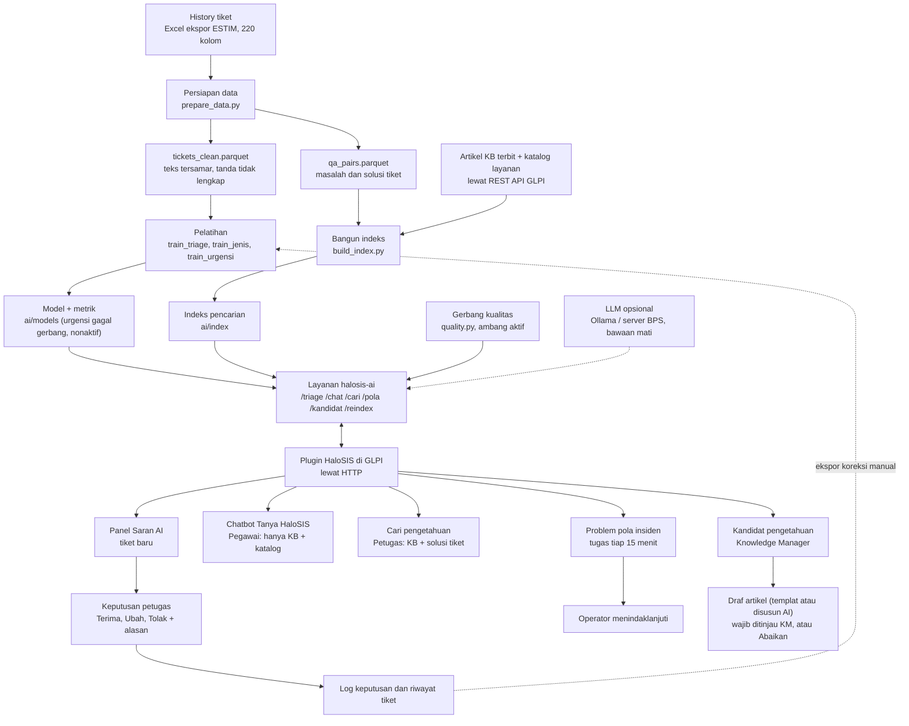

# Cara kerja AI HaloSIS, langkah demi langkah

Tanggal: 5 Nov 2026, diperbarui 7 Nov 2026 · Branch `dev`. Tujuan: mengecek kesesuaian implementasi dengan PoC di dokumen
*Kelompok 4 AKPSI-6* §2.4.7 (hal. 48–60). Nomor halaman mengikuti PDF AKPSI-6 tersebut.

**Cara dokumen ini dibuat.** Sumber kebenarannya adalah kode (`ai/`, `plugins/halosis/src/`), metrik tersimpan
(`ai/models/*.metrics.json`), dan `reports/`. README tidak dipakai sebagai bukti. Pembaruan 7 Nov memakai hasil skrip bagian C
dan gate AKHIR: 83 tes AI lulus dan e2e lolos (`reports/matriks_uji_br.md`).

- Metrik model jenis diambil dari `reports/triase.md`, sebab model ini tidak punya berkas `.metrics.json`.

Rujukan ditulis `file:baris`, relatif dari folder proyek. Rujukan di §1–3 dan §6 yang tidak ikut diperbarui mengikuti commit
`87a1609`, jadi nomor barisnya bisa bergeser.

**Ringkasan untuk pembaca cepat**

- AI HaloSIS hanya **menyarankan**. Keputusan tetap di tangan petugas (Terima/Ubah/Tolak).
- Ada enam komponen: triase tim, jenis REQ/INC, urgensi, pencarian/chatbot, deteksi pola insiden, kandidat pengetahuan.
- Bawaannya semua model berjalan lokal di layanan `halosis-ai`, tanpa LLM. LLM hanya aktif bila dikonfigurasi lewat env.
- Urgensi saat ini tidak memakai model, karena model gagal gerbang skema B.
- Bila layanan AI mati, tiket tetap tersimpan dan fitur turun ke cara manual atau kata kunci.
- Implementasi **tidak identik** dengan PoC. Perbedaannya ada di §4, status temuan di §5.3, dan keterbatasan di §5.4.

---

## 1. Gambaran umum



Pembagian tugasnya:

| Bagian | Isi | Bukti |
| --- | --- | --- |
| Pipeline luring | Data disiapkan, model dilatih, indeks dibangun, dijalankan manual oleh Pengelola AI | `ai/scripts/` |
| Layanan AI | FastAPI, memuat model sekali saat mulai, input disamarkan dulu | `ai/service/app.py:83-107`, `:15` |
| Plugin GLPI | Memanggil layanan lewat HTTP (batas waktu bawaan 8 detik), menyimpan saran dan keputusan | `plugins/halosis/src/Ai/Service.php:43-77`, `Config.php:33` |
| Petugas | Satu-satunya pihak yang mengubah tiket | `plugins/halosis/src/Triage.php:634-699` |

---

## 2. Persiapan data

### 2.1 Sumber dan kolom

- **Sumber:** ekspor history `data ticketing (202601_202608).xlsx`, 220 kolom (`ai/scripts/prepare_data.py:3-5`, `:30`). Ekspor
  lama 137 kolom hanya dipakai untuk rekonsiliasi (`ai/scripts/prepare_data.py:29`).
- **Kolom yang dipakai:** jenis, nomor, judul, deskripsi, tim, status, tanggal dibuka/selesai/ditutup, percakapan,
  catatan penutupan, hasil SLA, urgensi, dampak, prioritas, rating (`ai/scripts/prepare_data.py:35-42`).
- **Tanggal:** serial Excel diubah menjadi tanggal (`ai/halosis_ai/dates.py:21-29`).

### 2.2 Penyamaran data pribadi

Urutannya penting: kata sandi lebih dulu, lalu email, NIP, NIK, telepon, nama (`ai/halosis_ai/privacy.py:42-55`).

1. Nilai setelah kata sandi/PIN/OTP menjadi `[RAHASIA]`, email `[EMAIL]`, NIP `[NIP]`, NIK `[NIK]`, HP `[TELEPON]`.
2. Nama setelah sapaan, nama lengkap, dan bagian nama dari kolom pengguna menjadi `[NAMA]`. Bagian nama yang juga kata
   umum (muncul ≥ 5 kali berhuruf kecil) tidak disamarkan (`ai/scripts/prepare_data.py:68-88`).
3. Kolom nama dihapus. ID pengguna diganti `U00001` dst., dan pemetaannya tidak disimpan
   (`ai/scripts/prepare_data.py:94-101`).
4. Hasil dipindai ulang. Bila masih ada pola data pribadi, keluaran **tidak disimpan** (`ai/scripts/prepare_data.py:227-232`).

Hasil: 17.015 nilai disamarkan (`reports/rekonsiliasi.md:61`). Saat aplikasi berjalan, plugin menyamarkan lagi
(`plugins/halosis/src/Privacy.php:14-29`), dan layanan AI menyamarkan sekali lagi (`ai/service/app.py:361`,
`ai/halosis_ai/triage_model.py:30-31`). Saringan PHP tidak mengenali nama. Saringan layanan saat berjalan hanya mengenali
nama setelah sapaan, karena daftar nama pengguna hanya ada saat pipeline luring.

### 2.3 Pembersihan dan penanda data tidak lengkap

Data bermasalah **ditandai, tidak dibuang** (`ai/scripts/prepare_data.py:52-59`, `:144-147`):

| Penanda | Baris | Bukti |
| --- | ---: | --- |
| Tanpa deskripsi | 34 | `reports/rekonsiliasi.md:35` |
| Tanpa tim | 3 | `reports/rekonsiliasi.md:36` |
| Selesai tanpa solusi yang bisa diambil | 758 | `reports/rekonsiliasi.md:37` |
| Total ditandai (satu baris bisa punya beberapa alasan) | 790 | `reports/rekonsiliasi.md:14` |

Hasil SLA yang memakai perkiraan juga ditandai di kolom `sla_imputasi` (`ai/scripts/prepare_data.py:142`).

### 2.4 Ekstraksi solusi

Teks solusi diambil dari percakapan untuk indeks pencarian (`ai/halosis_ai/conversations.py:109-125`):

1. Percakapan dipecah per pesan (`ai/halosis_ai/conversations.py:65-77`).
2. Pesan ditelusuri dari yang terakhir. Pesan lebih dari 5 menit sesudah tiket diselesaikan dilewati, karena biasanya
   berisi ucapan terima kasih atau survei (`ai/halosis_ai/conversations.py:106`, `:116-120`).
3. Pesan terakhir dari pemohon dilewati (`ai/halosis_ai/conversations.py:121-122`).
4. Kalimat template dan salam dibuang. Sisanya harus ≥ 5 kata dan bukan sekadar permintaan informasi atau keluhan
   (`ai/halosis_ai/conversations.py:90-101`).
5. Bila tidak ada, dipakai `close_notes`, lalu `resolution`, asalkan bukan template (`ai/scripts/prepare_data.py:135-137`).

Hanya tiket berstatus Closed/Resolved/Completed dengan solusi yang masuk `qa_pairs` (`ai/scripts/prepare_data.py:169-181`).

### 2.5 Jumlah baris dan pembagian data

Baris sumber 6.681, berhasil diproses 6.671, gagal 10 karena status tidak dikenal (`reports/rekonsiliasi.md:11-13`, `:26`).
Dokumen mencatat 6.682, selisih 1 REQ tanpa nomor (`reports/verifikasi_akhir.md:78`).

| Komponen | Cara bagi | Data | Bukti |
| --- | --- | --- | --- |
| Triase tim | Waktu: latih sebelum 1 Jul, uji sesudahnya. Pilih pengaturan: latih Jan–Mei, validasi Juni | 5.109 latih, 1.559 uji | `ai/scripts/train_triage.py:40-41`, `reports/triase.md:9` |
| Jenis REQ/INC | Waktu, sama dengan triase | 5.122 latih, 1.559 uji | `ai/scripts/train_jenis.py:29`, `reports/triase.md:143` |
| Urgensi | Validasi silang 5 lipatan bertingkat, seed 42, hanya insiden Medium/Low | 2.708 insiden | `ai/scripts/train_urgensi.py:43`, `:60-64`, `ai/models/urgensi.metrics.json` |
| Pencarian | Uji: korpus Jan–Jun, kueri Jul–Ags. Indeks aktif memuat semua bulan | 1.069 kueri | `reports/banding_solusi.md:7`, `ai/scripts/build_index.py:61-62` |
| Pola insiden | Tanpa pelatihan. Uji pada blok 1 jam | 666 insiden, 84 blok | `reports/banding_pola.md:7-9` |
| Kandidat pengetahuan | Tanpa pelatihan dan tanpa set uji | – | `ai/halosis_ai/candidates.py:27-68` |

Indeks aktif berisi 4.923 potongan: 4.897 tiket, 9 KB, 17 layanan (`reports/checklist_demo.md:24`). Ukuran
`ai/index/vectors.npy` cocok dengan jumlah itu. Jumlah baris `qa_pairs` tidak tercatat di laporan mana pun.

---

## 3. Komponen AI

### 3.1 Triase tim

**Tujuan.** Menyarankan tim penangan beserta keyakinannya, agar Operator tidak memilah dari nol.

**Input.** Hanya yang tersedia saat tiket dibuat: judul, deskripsi, jenis. Kolom routing, SLA, dan resolusi tidak dipakai
(`ai/scripts/train_triage.py:4-5`, `ai/halosis_ai/triage_model.py:28-35`). Label latihnya tim akhir.

**Langkah pemodelan.**

1. Teks disusun: token jenis, judul dua kali, deskripsi. Huruf kecil, angka menjadi `0` (`ai/halosis_ai/triage_model.py:28-35`).
2. Tim dengan < 30 tiket latih digabung ke "Lainnya" (`ai/scripts/train_triage.py:55-59`). Hasilnya 21 kelas
   (`reports/triase.md:10`).
3. Fitur TF-IDF kata (1–2 gram) ditambah karakter (3–5 gram, tahan salah ketik) (`ai/halosis_ai/triage_model.py:44-49`).
4. Pengaturan dipilih dari C = 3/10/30, dengan/tanpa bobot kelas, pada validasi Juni (`ai/scripts/train_triage.py:42`,
   `:82-92`). Terpilih C = 3 tanpa bobot (`reports/triase.md:43`).
5. Logistic Regression, probabilitasnya dikalibrasi (sigmoid, 5 lipatan) (`ai/halosis_ai/triage_model.py:50-52`).
6. Keyakinan = probabilitas tim teratas. Di bawah 0,70, atau tim teratas "Lainnya", ditandai perlu penilaian manual
   (`ai/halosis_ai/triage_model.py:25`, `:153-158`).
7. Tiga tiket latih paling mirip (TF-IDF, kosinus) disimpan sebagai penjelasan (`ai/halosis_ai/triage_model.py:112-134`).

**Evaluasi** pada 1.559 tiket Jul–Ags (`ai/models/triage.metrics.json`, `reports/triase.md:9-18`):

| Ukuran | Hasil |
| --- | ---: |
| Top-1 / Top-3 | 75,88% / 94,87% |
| MRR / F1 makro | 0,8563 / 69,00% |
| Pembanding "selalu tim terbanyak" | 10,97% |
| Keyakinan ≥ 70% | akurasi 88,35%, cakupan 50,67% tiket |
| Keyakinan < 70% | akurasi 63,07%, cakupan 49,33% tiket |
| Galat kalibrasi (ECE) | 9,37% |

Keyakinan model cenderung **lebih rendah** dari akurasinya. Contoh: pita 50–70% berakurasi 73,8%, dan tidak ada tiket di
pita 90% ke atas (`reports/triase.md:51-54`). Tim terlemah: Operator Pusat (recall 3,0%, presisi 8,3%) dan FASIH
(presisi 21,0%, recall 78,8%) (`reports/triase.md:67`, `:72`).

**Gerbang kualitas** (`ai/halosis_ai/quality.py:15-18`, `:80-90`, `reports/tata_kelola_ai.md:30`):

| Syarat | Batas | Model aktif |
| --- | --- | ---: |
| Top-1 | ≥ 0,68 (baseline PoC) | 0,7588 |
| Akurasi pada keyakinan ≥ ambang | ≥ 0,85 | 0,8835 |
| Recall tim besar terendah (tanpa "Lainnya") | ≥ 0,50 | 0,787 |
| Top-1/Top-3 dibanding versi sebelumnya | turun ≤ 2 poin | naik (0,7447 → 0,7588, 0,9301 → 0,9487) |

Model yang gagal saat latih ulang tidak menggantikan model aktif (`ai/scripts/train_triage.py:194-198`).

**Di aplikasi.**

1. Tiket baru memicu `Triage::onTicketAdd`, plugin memanggil `POST /triage`. Kegagalan AI tidak menggagalkan penyimpanan
   tiket (`plugins/halosis/src/Triage.php:95-106`, `:381-385`).
2. Nama tim history dipetakan ke kategori dan grup GLPI (`plugins/halosis/src/Triage.php:75-89`, `:523-546`). Tim yang tidak
   terpetakan memakai saran aturan kata kunci dan diberi catatan.
3. Bila selisih keyakinan dua kandidat teratas < 5 poin, tim dengan tiket aktif lebih sedikit disarankan
   (`plugins/halosis/src/Triage.php:495-518`).
4. Panel "Saran AI" menampilkan kategori, dampak, urgensi, prioritas, grup, tiga kandidat beserta beban kerjanya, dan tiket
   mirip (`plugins/halosis/templates/triase_panel.html.twig:93-116`, `:151-155`).

| Tingkat di panel | Syarat | Yang dilihat petugas | Bukti |
| --- | --- | --- | --- |
| Tinggi | Keyakinan ≥ 70 | "Direkomendasikan" | `plugins/halosis/src/Suggestion.php:81` |
| Sedang | 40–69 | "Pilih dari 3 kandidat" | `plugins/halosis/src/Suggestion.php:82` |
| Rendah | < 40, tim "Lainnya", atau model tidak lolos gerbang | "Perlu penilaian manual" | `plugins/halosis/src/Suggestion.php:76-78`, `Triage.php:458-461` |

Petugas memilih Terima, Ubah, atau Tolak. Ubah dan Tolak wajib beralasan minimal 5 karakter
(`plugins/halosis/src/Triage.php:33-34`, `:648-651`). Keputusan dicatat di tabel plugin dan Riwayat tiket
(`plugins/halosis/src/Triage.php:678-697`). Tiket tidak pernah berubah tanpa keputusan petugas.

**Bila mati.**

| Kondisi | Yang terjadi | Bukti |
| --- | --- | --- |
| Layanan gagal, tanpa API key | Tiket tersimpan tanpa saran. Operator menekan "Buat saran AI", atau tugas `TriageRetry` mencoba lagi | `plugins/halosis/src/Triage.php:129-136` |
| Tugas `TriageRetry` | Tiap 15 menit, maks. 5 kali per tiket, tiket ≤ 3 hari | `plugins/halosis/src/TriageRetry.php:23-29`, `plugins/halosis/hook.php:240` |
| Layanan gagal, API key diisi | Dicoba lewat penyedia AI eksternal | `plugins/halosis/src/Triage.php:138-139` |
| URL layanan dikosongkan | Aturan kata kunci (mode demo) | `plugins/halosis/src/Triage.php:139`, `:551-625` |
| Model belum lolos gerbang | Saran tampil sebagai referensi, tingkat Rendah, ada peringatan | `plugins/halosis/src/Triage.php:404-406`, `templates/triase_panel.html.twig:85-90` |

### 3.2 Jenis tiket REQ/INC

**Tujuan.** Memberi tahu petugas bila jenis tiket tampak salah. Ini penting karena tiket dari chatbot selalu dibuat sebagai
Insiden (`plugins/halosis/src/Chatbot.php:497`).

**Input.** Judul dan deskripsi, tanpa token jenis (`ai/halosis_ai/triage_model.py:38-40`).

**Langkah pemodelan.**

1. Fitur sama dengan triase (`ai/scripts/train_jenis.py:58`).
2. Logistic Regression C = 3, bobot kelas seimbang, dikalibrasi. Pengaturan ini tetap, tidak dipilih dari kisi
   (`ai/scripts/train_jenis.py:61`).
3. Ambang tampil 0,70 (`ai/scripts/train_jenis.py:30`).

**Evaluasi** pada 1.559 tiket Jul–Ags (`reports/triase.md:141-148`): akurasi 68,25%, F1 makro 67,52%, pembanding jenis
terbanyak 57,28%. Pada keyakinan ≥ 70%: akurasi 83,96%, cakupan 40,80%.

**Gerbang.** F1 makro harus mengungguli pembanding kelas mayoritas (0,6752 > 0,3642, `reports/audit_dokumen_e2e.md:173`) dan
tidak turun > 2 poin dari versi aktif (`ai/halosis_ai/quality.py:103-110`). Kandidat yang gagal tidak menggantikan model aktif
(`ai/scripts/train_jenis.py:64-72`).

**Di aplikasi.** Bagian dari jawaban `/triage` (`ai/service/app.py:255-263`). Panel menampilkan "Jenis disarankan" bila berbeda
dan keyakinan ≥ ambang, atau "Jenis: perlu ditinjau" pada keyakinan 40–69 (`plugins/halosis/src/TriagePanel.php:123-137`).
Petugas mengubah jenis di form tiket.

**Bila mati.** Model opsional. Bila tidak ada atau tidak lolos, `jenis_saran` kosong dan panel diam
(`ai/service/app.py:90-95`, `:257-259`).

### 3.3 Urgensi insiden

**Status.** Model urgensi **tidak dipakai**. Model gagal gerbang skema B, jadi panel memakai aturan kata kunci dan validasi Operator
(`reports/tata_kelola_ai.md` §5). Artefaknya disimpan untuk rollback.

**Tujuan.** Menyarankan urgensi insiden Rendah atau Sedang. Dampak dan prioritas diturunkan dari sini.

**Input.** Judul dan deskripsi, ditambah nama tim (`ai/halosis_ai/triage_model.py:56-58`). Label dari kolom `urgency`. Urgensi
High (12 tiket), urgensi kosong (57 tiket), dan seluruh REQ tidak dimodelkan (`ai/models/urgensi.metrics.json`).

**Langkah pemodelan.**

1. Fitur: TF-IDF kata dan karakter, ditambah one-hot nama tim (`ai/halosis_ai/triage_model.py:67-73`).
2. Logistic Regression C = 3, bobot kelas seimbang, keluarannya P(Low) (`ai/halosis_ai/triage_model.py:61-74`). Model ini
   **tidak dikalibrasi**.
3. Skema B: validasi silang bertingkat 5 lipatan luar × 5 lipatan dalam, dengan tim prediksi out-of-fold, karena tim itulah yang
   tersedia saat dipakai. Ambang dipilih di lipatan dalam.

**Evaluasi** skema B (`ai/models/urgensi.metrics.json`, `logs/train_urgensi.log`):

| Kelas | Aturan | Hasil | Pembanding | Syarat | Status |
| --- | --- | --- | ---: | --- | --- |
| Low | P(Low) ≥ 0,95 | presisi 50,00% (Wilson 26,80–73,20%), recall 1,38%, 14 tiket | 18,76% | presisi ≥ 75%, batas bawah Wilson > pembanding, ≥ 30 tiket | Gagal |
| Medium | P(Low) ≤ 0,40 | akurasi 84,11%, cakupan 48,12%, 1.303 tiket | 81,24% | akurasi > 84,24%, ≥ 30 tiket, rentang ambang antarlipatan ≤ 0,10 | Gagal, rentang 0,45 |

Sebagai pembanding, skema A (tim aktual) memberi Low 70,83% dan Medium 84,87%. Selisih ini menunjukkan tim aktual membuat hasil
terlihat lebih baik dari kondisi pemakaian. Sebanyak 81,24% label bernilai Medium, kemungkinan nilai bawaan formulir
(`reports/triase.md:170`, `:173`).

**Di aplikasi.**

1. Layanan tidak mengirim saran urgensi karena tidak ada kelas yang lolos (`ai/service/app.py:308`). Aturan yang sama berlaku bila
   model baru kelak lolos sebagian kelas.
2. Urgensi diambil dari aturan kata kunci, lalu divalidasi Operator (`plugins/halosis/src/Triage.php:574-587`).
3. Pemohon pejabat menaikkan urgensi satu tingkat (`plugins/halosis/src/Triage.php:190-195`).
4. Dampak = urgensi, naik satu tingkat bila ada ≥ 3 tiket serupa dalam jendela pola atau layanannya kritis (bawaan SSO, Email,
   Jaringan) (`plugins/halosis/src/Triage.php:183-208`, `plugins/halosis/src/Config.php:48`).
5. Prioritas mengikuti matriks GLPI (`plugins/halosis/src/Triage.php:155`).
6. Panel menampilkan urgensi dan alasan dampak (`plugins/halosis/templates/triase_panel.html.twig:119-125`).

**Bila mati.** Sama seperti kondisi sekarang: aturan kata kunci.

### 3.4 Pencarian dan chatbot

**Tujuan.** Menjawab pegawai sebelum tiket dibuat (`/chat`) dan membantu petugas mencari solusi lama (`/cari`).

**Input.** Pertanyaan yang sudah disamarkan. Indeks memuat artikel KB terbit, solusi tiket lama, dan katalog layanan
(`ai/scripts/build_index.py:3-9`). `/chat` hanya memakai artikel KB terbit dan katalog layanan (`ai/service/app.py:59`). Solusi tiket
lama hanya untuk petugas lewat `/cari`.

**Langkah pemodelan.**

1. Teks dipotong per 220 kata. Setiap potongan tiket memuat teks masalah utuh (`ai/halosis_ai/search.py:25`, `:53-79`).
2. Potongan diubah menjadi vektor 768 dimensi dengan `intfloat/multilingual-e5-base`, berawalan `passage:` untuk dokumen dan
   `query:` untuk pertanyaan (`ai/halosis_ai/search.py:23`, `:88-92`).
3. Vektor disimpan sebagai berkas `chunks.parquet` dan `vectors.npy`, bukan layanan basis data vektor
   (`ai/scripts/build_index.py:83-85`).
4. Pencarian = kosinus, satu hasil per sumber (`ai/halosis_ai/search.py:157-180`).
5. Keputusan chatbot (`ai/service/app.py:52-56`, `:359-382`):

| Skor | Mode | Yang dilihat pegawai |
| --- | --- | --- |
| ≥ 0,83 | `ekstraktif` (bawaan), `openai`, atau `anthropic` | Solusi teratas apa adanya beserta sumber, atau rangkuman LLM dari sumber. Bila LLM menilai konteks tidak memuat jawaban, pertanyaan ditolak |
| 0,78 sampai < 0,83, ada artikel KB | `pilihan` | Tidak dijawab, ditawari ≤ 3 judul artikel "Maksud Anda…?" dan Buat laporan |
| < 0,78, atau tidak ada artikel KB | `tidak-ditemukan` | "Belum menemukan jawaban", ditawari Buat laporan |

Prompt LLM melarang fakta tambahan dan membatasi jawaban pada potongan sumber (`ai/halosis_ai/llm.py`).

**Evaluasi.** Tidak ada penilaian manusia. Relevansi didekati dengan kesamaan tim: hasil dianggap benar bila berasal dari tiket
tim yang sama.

| Set uji | Top-1 | Top-3 | MRR | Bukti |
| --- | ---: | ---: | ---: | --- |
| Indeks aktif (aturan solusi baru, 1.069 kueri) | 72,50% | 89,06% | 0,8115 | `reports/banding_solusi.md:16` |
| e5, ekspor aktif (905 kueri) | 71,93% | 88,29% | 0,8073 | `reports/banding_embedding.md` (Reproduksi) |
| MiniLM PoC, set sama (905 kueri) | 68,29% | 83,76% | 0,7636 | `reports/banding_embedding.md` (Reproduksi) |
| 8 kasus real KB HaloSIS, e5 | 62,50% | 87,50% | 0,7614 | `reports/replikasi_poc.md` (Retrieval) |
| 8 kasus real KB HaloSIS, MiniLM | 75,00% | 87,50% | 0,8203 | `reports/replikasi_poc.md` (Retrieval) |

Kalibrasi ambang chat pada 35 sumber (`reports/kalibrasi_ambang.md`):

| Set proksi | Kueri | Dijawab | Pilihan | Ditolak |
| --- | ---: | ---: | ---: | ---: |
| Judul sumber (harus terjawab) | 35 | 100,00% | 0,00% | 0,00% |
| Rekaan tak terjawab (harus ditolak) | 24 | 0,00% | 37,50% | 62,50% |
| Masalah tiket Jul–Ags (sebaran nyata) | 905 | 68,51% | 31,38% | 0,11% |

Latensi `/chat`: p95 453,8 ms, dari 20 permintaan mode ekstraktif pada 29 Okt (`reports/latensi.md:9-11`). Generasi LLM belum
diukur secara sistematis. Satu jawaban `qwen2.5:3b` lokal butuh 4,3 detik (`reports/replikasi_poc.md`). Penggabungan solusi identik ditolak karena Top-1 turun 1,96 poin
(`reports/banding_solusi.md:35`).

**Gerbang.** Tidak ada gerbang otomatis. Ada syarat pada perubahan aturan solusi: turun ≤ 1 poin (`ai/scripts/banding_solusi.py:41`).
Penjaganya ambang skor dan pemindaian pola pribadi sebelum indeks ditulis (`ai/scripts/build_index.py:77-80`).

**Di aplikasi.**

- Pegawai bertanya di Tanya HaloSIS. Plugin menyaring dulu topik non-TI (kepegawaian, keuangan, umum) dan mengarahkannya ke unit
  terkait tanpa memanggil AI (`plugins/halosis/src/Chatbot.php:33-39`, `:140-148`).
- Sumber artikel dicek hak aksesnya. Bila pegawai tidak berhak, jawaban layanan dibuang dan dipakai pencarian KB lokal
  (`plugins/halosis/src/Chatbot.php:238-245`).
- Pegawai bisa menilai 1–5 atau membuat tiket dari percakapan (`plugins/halosis/src/Chatbot.php:463-507`).
- Petugas memakai halaman Cari knowledge: 10 hasil tanpa ambang, dengan tombol membantu/tidak membantu
  (`plugins/halosis/src/Controller/CariKnowledgeController.php:28-45`, `ai/service/app.py:458-468`, `plugins/halosis/ajax/feedback.php:4`).
- Artikel yang terbit, berubah, atau dihapus memperbarui indeks otomatis (`plugins/halosis/src/KnowledgeIndex.php:34-37`, `:113-121`).

**Bila mati.** Chatbot turun ke pencarian kata kunci atas artikel KB (`plugins/halosis/src/Chatbot.php:152-172`), lalu kutipan
artikel atau "belum menemukan". Cari knowledge turun ke mode kata kunci
(`plugins/halosis/src/Controller/CariKnowledgeController.php:46-50`). Kegagalan re-index hanya dicatat, dan indeks lama tetap
dipakai (`plugins/halosis/src/KnowledgeIndex.php:147-151`).

### 3.5 Deteksi pola insiden

**Tujuan.** Memberi peringatan dini bila banyak tiket mirip muncul dalam waktu singkat. Sistem tidak memperbaiki apa pun.

**Input.** Insiden belum selesai dalam 60 menit terakhir: judul dan 300 karakter awal deskripsi
(`plugins/halosis/src/PatternDetector.php:176-204`, `ai/service/app.py:396`). REQ ikut hanya bila diaktifkan
(`plugins/halosis/src/Config.php:46`).

**Langkah pemodelan.**

1. Teks diubah menjadi vektor e5 (`ai/service/app.py:397`).
2. Vektor dipusatkan: dikurangi rata-rata vektor indeks, lalu dinormalkan. Kosinus e5 mentah terlalu tinggi, bahkan untuk tiket
   tidak terkait (`ai/halosis_ai/patterns.py:3-6`, `:28-32`).
3. Metode bawaan `rata`: tiket urut waktu masuk ke kelompok dengan rata-rata kemiripan tertinggi bila ≥ ambang aktif (bawaan 0,50, diatur lewat `pattern_threshold` di Pengaturan AI) dan masih dalam
   jendela waktu; bila tidak, membuka kelompok baru (`ai/halosis_ai/patterns.py:35-56`).
4. Metode opsional `dbscan`: eps 0,50, min_samples 3, lalu anggota di luar jendela dibuang (`ai/halosis_ai/patterns.py:74-99`).
5. Kelompok < 3 tiket dibuang (`ai/halosis_ai/patterns.py:22-25`, `:61-62`).

**Evaluasi** pada 666 insiden Jul–Ags, 84 blok 1 jam, urutan waktu seperti produksi (`reports/banding_pola.md`, Reproduksi). Kualitas
didekati dengan kemurnian tim, bukan penilaian manusia.

| Metode | Kelompok | Tiket terkelompok | Kemurnian tim |
| --- | ---: | ---: | ---: |
| Rata-rata ≥ 0,50 (bawaan) | 8 | 25 | 0,917 |
| DBSCAN eps 0,50, min 3 | 8 | 25 | 0,917 |
| DBSCAN eps 0,40, min 3 | 3 | 10 | 0,889 |

**Gerbang.** Peringatan saja, tidak memblokir. Parameter aktif dinilai saat disimpan di Pengaturan AI lewat `POST /gerbang`, pada set `ai/scripts/gerbang_pola.py` (`ai/halosis_ai/quality.py`). Bawaan 8 kelompok, 25 tiket, kemurnian 0,917: lolos. Keputusan tetap lewat validasi manusia.

**Di aplikasi.**

1. Tugas `IncidentPattern` berjalan tiap 15 menit (`plugins/halosis/hook.php:235`).
2. Plugin memanggil `POST /pola` (`plugins/halosis/src/PatternDetector.php:228-247`).
3. Setiap kelompok menjadi Problem "Pola insiden: …", status Baru, dampak 4, ditugaskan ke grup Operator
   (`plugins/halosis/src/PatternDetector.php:358-378`). Pola yang masih terbuka menerima tiket baru, bukan Problem baru
   (`plugins/halosis/src/PatternDetector.php:353-355`, `:393-402`).
4. Petugas melihat banner pola, tautan pola di panel tiket, dan tren 12 minggu di dashboard
   (`plugins/halosis/src/PatternDetector.php:589-610`, `plugins/halosis/src/TriagePanel.php:183-190`,
   `plugins/halosis/src/Stats.php:544-574`). Petugas memutuskan tindak lanjutnya (`plugins/halosis/src/PatternDetector.php:520`).

**Bila mati.** Plugin memakai metode kata kunci: kategori sama, lalu judul dengan ≥ 2 kata sama dan overlap ≥ 0,5
(`plugins/halosis/src/PatternDetector.php:40-44`, `:276-344`). Metode yang dipakai ditulis di Problem
(`plugins/halosis/src/PatternDetector.php:499-517`).

### 3.6 Kandidat pengetahuan

**Tujuan.** Mengubah solusi yang berulang menjadi calon artikel KB untuk dikurasi Knowledge Manager.

**Input.** Ada dua sumber: solusi dalam indeks (`ai/halosis_ai/candidates.py:27-41`), dan tiket GLPI selesai dengan solusi ≥ 20
karakter yang tidak ditolak pemohon (`plugins/halosis/src/KnowledgeCandidates.php:54-99`).

**Langkah pemodelan.**

1. Satu baris per tiket, teks solusi dijadikan TF-IDF 1–2 gram (`ai/halosis_ai/candidates.py:30`, `:44`).
2. Dua solusi dianggap tetangga bila kosinus ≥ 0,75 (`ai/halosis_ai/candidates.py:16`, `:45`).
3. Solusi dengan tetangga terbanyak menjadi pusat klaster, anggotanya tidak dipakai lagi (`ai/halosis_ai/candidates.py:46-56`).
4. Syarat klaster: solusi pusat ≥ 10 kata dan ≥ 5 tiket, maksimal 20 klaster (`ai/halosis_ai/candidates.py:18`, `:27`, `:51-54`).

**Evaluasi.** Tidak ada metrik mutu. Hanya tes unit `ai/tests/test_candidates.py` dan uji alur dalam `reports/verifikasi_akhir.md:90`.

**Gerbang.** Kurasi manusia. Tidak ada yang terbit otomatis.

**Di aplikasi.** `GET /kandidat` (`ai/service/app.py:484`). Hasilnya disinkronkan plugin
(`plugins/halosis/src/KnowledgeCandidates.php:37-42`, `:104-137`). Knowledge Manager memilih "Jadikan artikel", yang membuat **draf**
tanpa target visibilitas (`KnowledgeCandidates::makeArticle`), atau "Abaikan" dengan alasan (`KnowledgeCandidates::ignore`).

Bila `LLM_PROVIDER≠none`, draf disusun LLM lewat `POST /kandidat/draf` dan diberi label "Disusun AI, wajib ditinjau Knowledge
Manager" (`KnowledgeCandidates::aiDraft`). Bila LLM mati atau gagal, plugin memakai templat masalah + solusi.

**Bila mati.** Sinkronisasi tetap membuat kandidat dari tiket GLPI dan melaporkan AI tidak tersedia
(`plugins/halosis/src/KnowledgeCandidates.php:37-42`, `:109-114`).

---

## 4. Banding PoC dan implementasi

Arti kolom **Status**: *Sama*, *Sama, diperluas*, *Beda*, *Tidak diulang*, *Tidak sebanding*.

Arti tanda pada kolom **Bukti uji**:

- ✓ = ada uji banding pada set data yang sama.
- ⚠ = ada angka atau tes pendukung, tetapi bukan banding pada set yang sama.
- ✗ = belum ada uji.
- – = tidak perlu banding.

### 4.1 Data dan triase

| # | Butir | Dokumen (hal.) | Implementasi | Status | Alasan | Bukti uji |
| --- | --- | --- | --- | --- | --- | --- |
| 1 | Platform inti | GLPI 78/100, Zammad 76/100 (58, 60) | Plugin di atas GLPI (`reports/rencana_uji.md:126`) | Sama | – | – `reports/verifikasi_akhir.md:24` |
| 2 | Posisi AI | Lapisan luar lewat API (54, 58–59) | Lewat HTTP, termasuk `build_index.py` yang kini memakai REST API GLPI. Layanan AI tidak punya kredensial DB GLPI | Sama | – | ⚠ `logs/akses_db.log` (jalur data: REST API, dorongan plugin, volume model/indeks) |
| 3 | Dataset | 6.700 baris, 6.682 valid: 3.905 REQ, 2.777 INC (50–51) | Ekspor 220 kolom, 6.681 baris | Beda | Ekspor baru memuat urgensi, dampak, prioritas, rating | ⚠ `reports/rekonsiliasi.md:11-13`, `reports/tata_kelola_ai.md:91` |
| 4 | Populasi routing | 6.659 tiket (51) | 6.668 tiket | Beda | Ikut ekspor baru | ⚠ `reports/triase.md:9` |
| 5 | Cara split | Acak, random_state 42, uji 20%: 5.319 / 1.339 (51) | Produksi tetap split waktu: Jan–Jun / Jul–Ags, 5.109 / 1.559. Rekonstruksi PoC: acak rs42, 5.334 / 1.334 | Beda | Split waktu meniru pemakaian nyata (`reports/triase.md:27`). Jumlah PoC tidak bisa diperoleh persis dari data ini | ✓ `reports/replikasi_poc.md` (Triase) |
| 6 | Jumlah kelas | 39 grup (51, 54) | Produksi 21 kelas, tim < 30 tiket → "Lainnya". Rekonstruksi: 39 grup terbesar (1.324 tiket uji) dan 56 grup | Beda | Tim kecil tidak bisa dipelajari andal. "Lainnya" selalu manual. Data ini punya 56 grup, jadi 39 grup diambil dari grup terbanyak tiketnya | ✓ `reports/replikasi_poc.md`, `reports/replikasi_poc_per_grup.csv` |
| 7 | Metode triase | TF-IDF dibanding embedding (54); hal. 113 menyebut Similarity/Embedding | TF-IDF kata + karakter, Logistic Regression terkalibrasi. Tanpa embedding | Beda | PoC paling cocok dibaca sebagai k-NN (MRR TF-IDF 0,7991 vs dokumen 0,7989). Pada 39 grup, LR lebih tinggi dari k-NN pada Top-1 untuk ketiga fitur, tetapi F1 makronya lebih rendah | ✓ `reports/replikasi_poc.md` (rekonstruksi, kode PoC asli tidak ada) |
| 8 | Metrik triase | Top-1 68,33 / 70,43%, Top-3 90,89 / 90,29%, MRR 0,7989 / 0,8092 (54) | Pada set uji sama, baris "label asli", 39 grup: Top-1 78,47%, Top-3 91,31%, MRR 0,8505, F1 makro 40,62%. Rekonstruksi k-NN: Top-1 67,67–68,88% (TF-IDF, MiniLM), F1 makro 45,45–50,16% | Sama jenis metriknya, kini sebanding lewat rekonstruksi | Pembanding adil adalah baris "label asli", bukan "label gabungan" (82,55%) yang memudahkan tugas dengan kelas "Lainnya". Angka produksi 75,88% tetap memakai split waktu | ✓ `reports/replikasi_poc.md` |
| 9 | Kinerja per tim | Operator Pusat 70 dari 83 tiket salah; kinerja tidak merata (55) | Operator Pusat recall 3,0% dari 67 tiket (±65 salah) | Sama temuannya, kelemahan masih ada | Tiket Operator Pusat beragam | – `reports/triase.md:67` |
| 10 | Confidence-aware | Kandidat Top, confidence, validasi manusia (54); tiga tingkat (100) | Tingkat 70/40, Top-3, "Lainnya" selalu manual | Sama, diperluas | – | – `reports/triase.md:16-17`, `ai/tests/test_triage_model.py:40`, `reports/kalibrasi_ambang.md` (pita 40–70%: akurasi 66,63%) |

### 4.2 Pencarian dan jawaban

| # | Butir | Dokumen (hal.) | Implementasi | Status | Alasan | Bukti uji |
| --- | --- | --- | --- | --- | --- | --- |
| 11 | Model embedding | `paraphrase-multilingual-MiniLM-L12-v2` (53, 56) | `intfloat/multilingual-e5-base` | Beda | Lebih baik di ketiga metrik pada 905 kueri ekspor aktif (Top-1 71,93 vs 68,29%, Top-3 88,29 vs 83,76%, MRR 0,8073 vs 0,7636); biayanya pengodean lebih lambat | ✓ `reports/banding_embedding.md` (Reproduksi), `ai/scripts/banding_embedding.py` |
| 12 | Uji retrieval terkendali | 8 kasus: TF-IDF dan embedding sama-sama 100%, MRR 1,0 (53) | 8 kasus real dari KB HaloSIS existing: MiniLM Top-1 75%, Top-3 87,5%, MRR 0,8203; e5 62,5%, 87,5%, 0,7614 | Beda kasus | Teks 8 kasus PoC tidak ada di dokumen. n=8: 1 kasus = 12,5 poin. e5 tetap dipilih dari uji 905 kueri | ⚠ `reports/replikasi_poc.md` (Retrieval), `ai/scripts/kasus_retrieval_poc.json` |
| 13 | LLM | Qwen2.5 3B lewat Ollama (53, 55) | Bawaan `LLM_PROVIDER=none` (ekstraktif). Opsional lewat env: server kompatibel OpenAI (termasuk Ollama, profile `llm`) atau Anthropic. Demo: `qwen2.5:3b` lokal | Sama, opsional | Tanpa data keluar dan tanpa GPU secara bawaan; kutipan tidak bisa berhalusinasi | ⚠ `reports/replikasi_poc.md` (Ekstraktif vs Qwen), `logs/uji_llm.log`, `logs/draf_llm.log`. Hanya 10 uji pertanyaan |
| 14 | Grounding dan fallback | RAG + grounding + fallback + HITL; ada uji unknown-answer (55–56) | Sumber hanya KB terbit + katalog layanan. Di bawah ambang tidak menjawab, mode pilihan, tawaran laporan | Sama | – | ✓ `reports/kalibrasi_ambang.md`, `tests/e2e/alur_alternatif.js`, `ai/tests/test_service.py`. Keterbatasan: §5.4 no. 8 |
| 15 | Similarity E2E | 0,8592 pada satu pertanyaan (55) | Ambang 0,83 untuk e5 | Tidak sebanding | Skala kosinus MiniLM dan e5 berbeda (`reports/banding_embedding.md:36`) | – |

### 4.3 Deteksi pola insiden

| # | Butir | Dokumen (hal.) | Implementasi | Status | Alasan | Bukti uji |
| --- | --- | --- | --- | --- | --- | --- |
| 16 | Metode | DBSCAN atas seluruh INC, lalu sliding window (56) | Bawaan rata-rata kemiripan per jendela; DBSCAN opsional di Pengaturan AI | Beda | Hasil setara (8 kelompok, 25 tiket, kemurnian 0,917 pada urutan waktu), lebih cepat, DBSCAN menarik tiket lain lewat efek rantai | ✓ `reports/banding_pola.md` (Reproduksi), `ai/scripts/banding_pola.py` |
| 17 | eps | 0,25 (56) | 0,50 pada metode DBSCAN | Beda | Eps PoC untuk MiniLM tanpa pemusatan; jarak tiket bertopik sama pada e5 terpusat ±0,4 | ⚠ `reports/banding_pola.md`. Eps 0,25 hanya dijalankan dengan MiniLM di rekonstruksi, tidak pada e5 terpusat |
| 18 | min_samples | 5 (56) | 3 | Beda | Mengikuti aturan minimum 3 insiden; 5 hampir tidak pernah tercapai per jendela | ⚠ `reports/banding_pola.md:30`, tanpa baris uji min 5 |
| 19 | Similarity | 0,70 (56) | 0,50 pada vektor terpusat, rata-rata ke semua anggota | Beda | Kosinus e5 mentah ±0,85–0,94 bahkan untuk tiket tak terkait | ⚠ `ai/halosis_ai/patterns.py:3-6`, `reports/banding_pola.md:17`. Ambang 0,70 tidak diuji |
| 20 | Jendela | 1 jam (56) | 60 menit, dicek tiap 15 menit | Sama | – | – `plugins/halosis/src/Config.php:39`, `plugins/halosis/hook.php:235` |
| 21 | Minimum insiden | 3 (56) | 3 | Sama | Disamakan pada 29 Okt (`reports/tata_kelola_ai.md:90`) | – `plugins/halosis/src/Config.php:38` |
| 22 | Penggabungan hasil | Tanpa union-find; set tiket ganda dideduplikasi (56) | Pengelompokan rakus; pola terbuka dipakai ulang lewat tanda pola | Beda | Satu Problem per pola agar Operator tidak dibanjiri | ⚠ `plugins/halosis/src/PatternDetector.php:353-355`, `reports/verifikasi_akhir.md:88` |
| 23 | Populasi | 2.777 INC (56) | INC secara bawaan; REQ opsional dan terpisah | Sama, diperluas | FR-04 menyebut request juga | – `reports/verifikasi_akhir.md:52` |
| 24 | Hasil deteksi | 14 klaster, 1.073 noise; 23 jendela → 17 episode (56) | Rekonstruksi 2.777 INC, metode PoC: 8 klaster, 1.011 noise; 19 → 19 atau 15 → 15 kandidat, tergantung tafsiran | Direkonstruksi, hasil berbeda | Metrik jarak, teks masukan, dan definisi jangkar tidak tertulis di dokumen | ⚠ `reports/replikasi_poc.md` (Pola) |
| 25 | Tren temporal | Kenaikan bulanan cluster BOT/FASIH (56) | Tren pola per minggu per topik, 12 minggu | Beda bentuk | Dibangun dari Problem yang terdeteksi, bukan klaster history | ⚠ `plugins/halosis/src/Stats.php:544-574` |
| 26 | Validasi pola | Kandidat divalidasi manusia/service owner (57) | Problem status Baru, ditugaskan ke Operator | Sama | – | – `plugins/halosis/src/PatternDetector.php:358-378` |

### 4.4 Human-in-the-loop dan kematangan bukti

| # | Butir | Dokumen (hal.) | Implementasi | Status | Alasan | Bukti uji |
| --- | --- | --- | --- | --- | --- | --- |
| 27 | HITL | Approval solusi native GLPI, tiket #156 (57); Approve/Reject/Override (101–102) | Terima/Ubah/Tolak per saran + alasan. Approval solusi GLPI tetap ada | Sama, diperluas | Keputusan dicatat per rekomendasi, bukan hanya per solusi | – `reports/verifikasi_akhir.md:90`, `tests/e2e/alur_alternatif.js` |
| 28 | Audit trail | Actor, timestamp, decision (57, 102) | Tabel keputusan, versi model per saran, Riwayat tiket, ekspor koreksi | Sama, diperluas | – | – `plugins/halosis/src/Triage.php:678-697`, `reports/tata_kelola_ai.md:44` |
| 29 | Evidence Maturity | 8 area, bukti PoC ≠ siap produksi (59) | Lihat tabel berikut | Sama prinsipnya | – | – |

Status di tabel berikut adalah penilaian pemeriksaan ini, bukan status resmi. Semua area **belum siap produksi**, sesuai hal. 59
dan 61.

| Area | Status PoC (hal. 59) | Bukti implementasi | Status sekarang |
| --- | --- | --- | --- |
| ITSM core | Proven PoC | Regresi demo (`reports/verifikasi_akhir.md:86`) | Diuji di prototipe |
| SLA | Proven PoC | Di luar lingkup AI; regresi demo sama | Diuji di prototipe |
| Knowledge | Proven PoC | Re-index dan tes (`ai/tests/test_reindex.py`) | Diuji di prototipe |
| AI retrieval | PoC proven | 905 kueri proksi tim (`reports/banding_embedding.md`), 8 kasus KB (`reports/replikasi_poc.md`) | Diuji pada history dan 8 kasus, penilaian relevansi tim belum ada |
| AI routing | PoC evidence | 1.559 tiket split waktu, rekonstruksi 1.324 tiket split PoC (`reports/replikasi_poc.md`) | Bukti lebih dekat ke pemakaian nyata, belum pernah dipakai petugas sungguhan |
| Conversation | Partially proven | 10 uji ekstraktif vs Qwen, 9 sesuai harapan (`reports/replikasi_poc.md`); alur alternatif e2e | Partially proven |
| Proactive detection | Partially proven | 666 insiden, proksi tim (`reports/banding_pola.md:15-19`), uji alur 3 tiket (`reports/verifikasi_akhir.md:88`) | Partially proven |
| HITL | Proven PoC | Alur e2e 11/11 pada 7 Nov (`logs/akhir_e2e3_alur_alternatif.log`) | Diuji di prototipe |

---

## 5. Hal yang hanya ada di satu sisi

### 5.1 Ada di implementasi, tidak ada di PoC §2.4.7

| Hal | Lokasi |
| --- | --- |
| Model jenis REQ/INC | `ai/scripts/train_jenis.py` |
| Model urgensi insiden dengan ambang per kelas (dokumen hanya menilai kelayakannya, hal. 15) | `ai/scripts/train_urgensi.py` |
| Sinyal dampak: tiket serupa, layanan kritis | `plugins/halosis/src/Triage.php:183-208` |
| Kenaikan urgensi pemohon pejabat | `plugins/halosis/src/Triage.php:190-195` |
| Gerbang kualitas otomatis, tampil di `/health` dan panel | `ai/halosis_ai/quality.py`, `ai/service/app.py:233-252` |
| Kalibrasi probabilitas triase | `ai/halosis_ai/triage_model.py:50-52` |
| Kelas gabungan "Lainnya" | `ai/scripts/train_triage.py:55-59` |
| Tiket mirip sebagai penjelasan saran | `ai/halosis_ai/triage_model.py:112-134` |
| Pemecah seri beban kerja | `plugins/halosis/src/Triage.php:495-518` |
| Pemusatan vektor pola | `ai/halosis_ai/patterns.py:28-32` |
| Aturan ekstraksi solusi dan bandingnya | `ai/halosis_ai/conversations.py:109-125`, `reports/banding_solusi.md` |
| Mode chat `pilihan` dan penolakan topik non-TI | `ai/service/app.py:366-372`, `plugins/halosis/src/Chatbot.php:140-148` |
| Draf artikel dari kandidat disusun LLM, dengan fallback templat dan label peninjauan | `ai/service/app.py:478-481`, `plugins/halosis/src/KnowledgeCandidates.php:290-323` |
| Katalog layanan masuk indeks | `plugins/halosis/src/KnowledgeIndex.php:53-81` |
| Kandidat pengetahuan otomatis | `ai/halosis_ai/candidates.py` |
| Fallback kata kunci dan percobaan ulang triase | `plugins/halosis/src/PatternDetector.php:276-344`, `plugins/halosis/src/TriageRetry.php` |
| Ekspor koreksi dan indikator drift | `plugins/halosis/src/Stats.php:399-420`, `:771`, `plugins/halosis/src/Controller/DashboardController.php:63` |
| Ringkasan ekstraktif deskripsi panjang | `plugins/halosis/src/Summary.php` |
| Batas permintaan, metrik Prometheus, log latensi tanpa teks | `ai/service/app.py:72-81`, `:113-159` |

### 5.2 Ada di PoC atau dokumen, tidak diimplementasikan

| Hal | Dokumen (hal.) | Kondisi sekarang |
| --- | --- | --- |
| LLM lokal Qwen2.5 3B lewat Ollama | 53, 55 | Tersedia sebagai opsi env dan profile `llm`, bukan bawaan |
| Routing berbasis embedding | 54 | Tidak ada di produksi. Diuji di rekonstruksi, triase produksi tetap TF-IDF |
| Banding TF-IDF vs embedding per tim | 54–55 | Ada di `reports/replikasi_poc_per_grup.csv` |
| Uji retrieval terkendali 8 kasus | 53 | Kasus asli PoC tidak tersedia. Diganti 8 kasus real dari KB HaloSIS |
| Klasterisasi DBSCAN atas seluruh history | 56 | Hanya direkonstruksi untuk uji. Di produksi DBSCAN tetap per jendela waktu |
| Evaluasi sliding window 23 → 17 episode | 56 | Direkonstruksi, hasil tidak sama (§4.3 no. 24) |
| Layanan basis data vektor | 22 (Tabel 2.10) | Berkas numpy di memori (`reports/audit_kelengkapan.md:199`) |
| Ambang dari validation dataset, cost of error, dan UAT | 100 | Baru validation dataset (`reports/kalibrasi_ambang.md`). Cost of error dan UAT belum ada |

### 5.3 Catatan pemeriksaan yang perlu ditindaklanjuti

Status per 7 Nov 2026, setelah bagian A, B, dan C.

| No | Temuan | Status | Bukti |
| --- | --- | --- | --- |
| 1 | Urgensi dievaluasi dengan tim akhir, tetapi dipakai dengan tim saran AI | **Selesai.** Gerbang memakai skema B (tim prediksi out-of-fold). Urgensi gagal gerbang, jadi dinonaktifkan | `reports/usulan_gerbang_a.md`, `reports/tata_kelola_ai.md:96-97`, `ai/service/app.py:308` |
| 2 | Ambang urgensi dipilih dan dilaporkan pada prediksi yang sama | **Selesai.** Ambang dipilih di lipatan dalam | `reports/usulan_gerbang_a.md`, `logs/a3a4_metrik.log` |
| 3 | Chatbot mengutip solusi tiket lama yang belum ditinjau | **Selesai.** `/chat` hanya memakai KB terbit dan katalog layanan | `ai/service/app.py:59`, `:365`, `reports/banding_solusi.md` |
| 4 | Skrip `banding_embedding.md` dan `banding_pola.md` tidak ada di repo | **Selesai.** Kedua uji dapat diulang | `ai/scripts/banding_embedding.py`, `ai/scripts/banding_pola.py` |
| 5 | Perubahan triase tidak pernah dibandingkan pada set yang sama dengan PoC | **Selesai,** sebagai rekonstruksi | `reports/replikasi_poc.md` (Triase) |
| 6 | `build_index.py` membaca DB GLPI langsung | **Selesai.** Kini lewat REST API | `ai/scripts/build_index.py:85`, `logs/akses_db.log` |
| 7 | Ambang chat tanpa laporan kalibrasi | **Sebagian.** Laporan ada, pada 35 sumber, tetapi ambang belum boleh dinyatakan terkalibrasi sebelum penilaian tim dan UAT | `reports/kalibrasi_ambang.md` |
| 8 | Ambang pola tidak bisa diubah dari Pengaturan AI | **Selesai** | `plugins/halosis/src/PatternDetector.php:238`, `logs/a4_pola_set.log` |
| 9 | Model triase dilatih Jan–Jun dan diuji Jul–Ags | **Bukan kekurangan.** Ini split waktu yang disengaja agar uji meniru pemakaian nyata. Pelatihan ulang mengikuti §6 | `ai/scripts/train_triage.py:134-138`, `reports/triase.md:27` |
| 10 | `tata_kelola_ai.md` tertinggal: recall "Lainnya" 0,335 dan SOP "belum" | **Selesai.** Recall 0,4319, SOP dan katalog layanan terindeks, status urgensi dicatat | `reports/tata_kelola_ai.md`, `ai/models/triage.metrics.json` |
| 11 | Gerbang akurasi triase hanya berlaku pada ambang 70% | **Selesai.** Gerbang memakai ambang aktif | `ai/halosis_ai/quality.py:96`, `:143`, `logs/a4_pengaturan_aktif.log` |
| 12 | Dokumen PoC: 5.319 + 1.339 = 6.658, populasi 6.659 | **Terbuka.** Perlu konfirmasi tim PoC | Dokumen hal. 51 |

### 5.4 Keterbatasan dan cara membaca hasil

1. **Rekonstruksi, bukan replikasi persis.** Kode PoC asli tidak ada. Rekonstruksi paling cocok dengan k-NN (MRR TF-IDF 0,7991 vs dokumen 0,7989), jadi PoC dibaca sebagai k-NN.
2. **Pembanding adil HaloSIS vs PoC adalah baris "label asli".** Top-1 HaloSIS 78,47%, sedangkan k-NN rekonstruksi 67,67–68,88% (TF-IDF, MiniLM). Baris "label gabungan" (82,55%) tidak dipakai untuk banding ini.
3. **F1 makro HaloSIS lebih rendah dari k-NN.** Pada 39 grup, label asli: 40,62% vs 45,45–50,16%. Penyebabnya grup kecil, yang digabung ke "Lainnya" dan otomatis dihitung salah. Top-1 yang lebih tinggi tidak berarti semua tim terlayani lebih baik.
4. **Retrieval 8 kasus real dari KB HaloSIS existing:** Top-1 MiniLM 75%, e5 62,5%. Dengan n=8, 1 kasus bernilai 12,5 poin, jadi selisih ini tidak cukup untuk mengganti model. e5 tetap dipilih berdasar uji 905 kueri. K8 gagal pada kedua model (peringkat 16 dan 11) karena beda istilah awam dan teknis. Saran: artikel KB mencantumkan gejala dengan bahasa awam.
5. **Draf artikel "Kandidat → artikel" disusun LLM** lewat `halosis-ai` bila `LLM_PROVIDER≠none`, dengan fallback templat dan label "Disusun AI, wajib ditinjau Knowledge Manager". Uji `qwen2.5:3b` menunjukkan model kecil bisa menambah frasa di luar sumber, jadi peninjauan KM wajib.
6. **Layanan AI tidak mengakses DB GLPI.** Jalur data hanya REST API, dorongan plugin, dan volume model/indeks (`logs/akses_db.log`).
7. **Urgensi tetap nonaktif** karena gagal gerbang skema B. Ini bukti tata kelola berjalan: panel memakai aturan kata kunci dan validasi Operator (`reports/tata_kelola_ai.md:97`).
8. **Keluhan non-TI bisa masuk mode `pilihan`.** Contoh "Kursi kantor saya patah": tiga artikel KB bersaing pada skor 0,7899, 0,7872, dan 0,7820, sedikit di atas ambang 0,78. Ini konsisten dengan kalibrasi pada 35 sumber: 37,50% pertanyaan rekaan masuk `pilihan`, 0% dijawab. Jawaban langsung tetap tidak diberikan dan tawaran laporan tetap ada (`tests/e2e/alur_alternatif.js`). Margin ambang tipis: pada 0,82, 8,33% rekaan sudah dijawab (`reports/kalibrasi_ambang.md`).
9. **E2E AKHIR diulang.** Putaran pertama berjalan pada image `halosis-ai` yang belum dibangun ulang setelah commit B, sehingga `/kandidat/draf` menjawab 404. Hasil yang berlaku berasal dari image baru. Kalimat uji UC-01 4a / UC-02 5a juga diganti ke "Cuaca di Bali besok pagi" (mode `tidak-ditemukan`, skor teratas 0,7819 dari sumber non-KB) karena kalimat lama kini masuk mode `pilihan`. Assert tidak diubah.

### 5.5 Rekomendasi penerapan LLM di BPS

| Pilihan | Syarat |
| --- | --- |
| Server LLM internal BPS (kompatibel OpenAI) | Pilihan utama. Cukup ubah `LLM_BASE_URL`, `LLM_MODEL`, dan `LLM_API_KEY` |
| Model terbuka di server BPS, mis. Qwen 7B/14B | Pilihan utama bila server internal belum ada. Mutu perlu diuji ulang pada 10 pertanyaan dan draf artikel |
| Cloud atau Claude | Hanya dengan penyamaran dan izin BPS |
| `qwen2.5:3b` lokal | Hanya untuk demo |

---

## 6. Melatih ulang model

### 6.1 Siapa yang berwenang

| Keputusan | Mengerjakan | Memutuskan | Bukti |
| --- | --- | --- | --- |
| Rilis atau rollback model triase | Pengelola AI | Manajemen, setelah konsultasi Operator | `reports/tata_kelola_ai.md:13` |
| Ambang keyakinan triase | Administrator Sistem | Manajemen | `reports/tata_kelola_ai.md:14` |
| Ambang chat | Administrator Sistem | Knowledge Manager | `reports/tata_kelola_ai.md:15` |
| Parameter deteksi pola | Administrator Sistem | Operator | `reports/tata_kelola_ai.md:16` |
| Sumber knowledge | Pengelola AI | Knowledge Manager | `reports/tata_kelola_ai.md:17` |

Pengelola AI adalah 1–2 orang (`reports/tata_kelola_ai.md:22`). Anggota tim lain tidak perlu melatih ulang.

### 6.2 Urutan perintah

Jalankan dari folder proyek. Data mentah tidak boleh masuk repo.

```bash
# 0. Simpan salinan model aktif di luar repo (minimal 2 versi terakhir).
#    Skrip latih langsung menimpa ai/models bila kandidat lolos gerbang.

# 1. Letakkan ekspor Excel di data/raw/, lalu siapkan data
.venv/bin/python ai/scripts/prepare_data.py

# 2. Laporan data (opsional, untuk pemeriksaan)
.venv/bin/python ai/scripts/reconcile.py
.venv/bin/python ai/scripts/eda.py
.venv/bin/python ai/scripts/baseline.py

# 3. Latih model
.venv/bin/python ai/scripts/train_triage.py
.venv/bin/python ai/scripts/train_jenis.py
.venv/bin/python ai/scripts/train_urgensi.py

# 4. Bangun indeks. Pastikan docker compose menyala agar artikel KB ikut
.venv/bin/python ai/scripts/build_index.py

# 5. Setelah disetujui Manajemen: muat model dan cek versinya
docker compose restart halosis-ai
curl -s localhost:8001/health
```

Hal yang perlu diperhatikan:

1. **Periksa laporan.** Baca `reports/triase.md` bagian "Latih ulang" dan pastikan gerbang lolos.
2. **Perilaku penulisan berbeda.** `train_triage.py` dan `train_jenis.py` hanya mengganti model bila lolos
   (`ai/scripts/train_triage.py:194-198`, `ai/scripts/train_jenis.py:71-72`). `train_urgensi.py` selalu menulis, dan gerbangnya
   baru berlaku saat layanan berjalan (`ai/scripts/train_urgensi.py:89-93`).
3. **Layanan tetap memakai model lama sampai di-restart,** karena model dimuat sekali saat mulai (`ai/service/app.py:83-107`).
   Jadi persetujuan Manajemen harus terjadi sebelum `restart`.
4. **Versi pustaka harus sama.** scikit-learn dan numpy dikunci agar model bisa dimuat (`ai/requirements-service.txt:1-4`).
5. **Data koreksi.** Keputusan Ubah/Tolak diekspor lewat dashboard Kinerja AI, tetapi penggabungannya ke data latih masih manual
   (`reports/tata_kelola_ai.md:33`).
6. **Sesudah rilis.** Catat di `reports/tata_kelola_ai.md` §5, pantau rasio Ubah+Tolak selama 2 minggu, dan rollback bila naik
   lebih dari 10 poin (`reports/tata_kelola_ai.md:34-35`).

---

## 7. Daftar istilah

| Istilah | Arti sederhana |
| --- | --- |
| Akurasi | Porsi tebakan yang benar |
| Ambang | Batas nilai untuk memutuskan, mis. keyakinan ≥ 70% |
| Bobot kelas | Pengaturan agar kelas yang jarang tidak diabaikan model |
| Chunk / potongan | Bagian teks pendek yang disimpan di indeks |
| DBSCAN | Metode pengelompokan yang mengumpulkan titik berdekatan tanpa perlu menentukan jumlah kelompok |
| ECE | Selisih rata-rata antara keyakinan model dan akurasi sebenarnya. Makin kecil makin baik |
| Efek rantai | Dua tiket berbeda tergabung karena sama-sama dekat dengan tiket ketiga |
| Ekstraktif | Jawaban berupa kutipan sumber apa adanya, tanpa dikarang model bahasa |
| Embedding | Mengubah teks menjadi deretan angka, sehingga teks bermakna mirip berdekatan |
| eps | Jarak maksimal dua tiket agar dianggap tetangga di DBSCAN |
| F1 makro | Rata-rata F1 semua kelas dengan bobot sama, sehingga tim kecil ikut berpengaruh |
| Gerbang kualitas | Syarat angka yang harus dipenuhi model sebelum dipakai |
| Grounding | Jawaban AI harus berdasar sumber, bukan karangan |
| HITL | Human-in-the-Loop: manusia memeriksa dan memutuskan hasil AI |
| Kalibrasi | Penyesuaian agar keyakinan 70% berarti benar ±70% dari waktu |
| Kelas | Pilihan jawaban model, mis. satu tim |
| Keyakinan | Peluang yang diberikan model untuk jawabannya |
| Kosinus | Ukuran kemiripan dua vektor. Makin dekat 1 makin mirip |
| LLM | Model bahasa besar yang bisa menyusun kalimat |
| Logistic Regression | Model statistik yang menghitung peluang tiap kelas dari fitur |
| min_samples | Jumlah tetangga minimum agar titik menjadi inti kelompok di DBSCAN |
| MRR | Rata-rata 1 ÷ peringkat jawaban benar. Benar di urutan 1 = 1; urutan 2 = 0,5 |
| N-gram | Potongan 1, 2, atau lebih kata/huruf berurutan |
| One-hot | Mengubah pilihan, mis. nama tim, menjadi kolom 0/1 |
| Pembanding | Tebakan sederhana sebagai acuan, mis. selalu memilih kelas terbanyak |
| Pemusatan vektor | Mengurangi rata-rata korpus agar perbedaan antartiket lebih terlihat |
| Presisi | Dari yang ditebak kelas X, berapa yang benar-benar X |
| Proksi | Ukuran pengganti saat ukuran sebenarnya tidak tersedia |
| RAG | Mencari sumber lebih dulu, lalu menjawab berdasarkan sumber itu |
| Recall | Dari semua yang sebenarnya kelas X, berapa yang tertangkap |
| Sigmoid (kalibrasi) | Rumus penyesuai keyakinan model |
| Split | Pembagian data menjadi data latih dan data uji |
| TF-IDF | Pembobotan kata: kata khas tiket bernilai tinggi, kata umum bernilai rendah |
| Top-1 / Top-3 | Jawaban benar ada di 1 / 3 tebakan teratas |
| Validasi silang | Data dibagi beberapa lipatan, tiap lipatan bergiliran menjadi data uji |
| Wilson | Rentang kepercayaan untuk suatu persentase, lebih andal pada sampel kecil |

---

## Kesimpulan

Secara prinsip implementasi sesuai PoC: GLPI sebagai sistem pencatatan, AI sebagai lapisan terpisah, keyakinan bertingkat,
validasi manusia, dan jawaban berdasar sumber. Secara teknis implementasi berbeda pada model embedding, metode dan kelas triase,
cara split, serta parameter deteksi pola. LLM kini tersedia sebagai opsi, dengan bawaan ekstraktif.

Perbedaan utama sudah punya bukti. Triase, embedding, dan metode pola diuji pada set yang sama dengan skrip yang bisa diulang di
repo. Karena kode PoC asli tidak ada, hasil triase dan pola adalah **rekonstruksi, bukan replikasi persis**. Pada split PoC, baris
"label asli" memberi Top-1 78,47% vs k-NN 67,67–68,88%, tetapi F1 makro HaloSIS lebih rendah (40,62% vs 45,45–50,16%) karena
grup kecil. Hasil pola PoC (23 → 17 episode) tidak terulang. Angka 75,88% memakai split waktu, jadi tidak dibandingkan langsung
dengan PoC.

Gerbang kualitas terbukti berjalan: urgensi nonaktif karena gagal skema B. Semua area tetap **belum siap produksi**. Yang masih
diperlukan: penilaian relevansi oleh tim, UAT dan analisis biaya kesalahan untuk ambang, serta uji usability NFR-08.
